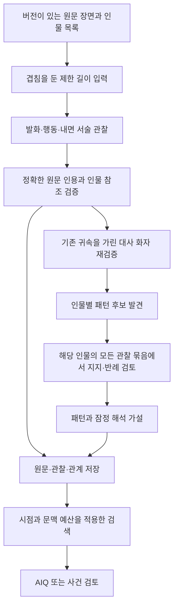

# 인물 기억: 원문 관찰, 패턴, 해석 가설

`prolog-ai` 0.1.0은 장면의 작은 발화·행동을 모아 인물별 반복과 반례를 검토하는
선택적 기억 계층을 제공한다. 기존 함수를 기억 없이 부르는 방식은 유지된다.
학습된 모델을 새로 만드는 기능은 아니며, 모델의 추출·해석 정확도는 실제 원고로 별도 평가해야 한다.

## 처리 구조



온톨로지는 Pydantic 스키마와 ID 참조로 표현한다. 별도 그래프 서버 없이 JSON/SQLite로 쓸 수 있다.

| 종류 | 보존하는 정보 | 의미 |
| --- | --- | --- |
| Character | ID, 이름, 별명 | 인물 식별. ASS 객체의 다른 필드는 자동으로 사실화하지 않음 |
| Scene | ID, revision, order, 원문, 선택적 chapter_id/story_time | 독서 순서와 작중 시간을 구분 |
| Observation | 인물, 상대, 발화/행동 종류, 맥락, 출처 | 확정/불확실한 주체를 구분. 단 한 번의 디테일도 남김 |
| Evidence | scene_id, revision, start, end, quote | Python 문자열의 0부터 시작하는 `[start:end]` 코드포인트 위치 |
| Pattern | 조건, 지지 관찰, 반례, 검토 범위 | 서로 다른 두 장면 이상이 지지해야 반복으로 승격 |
| Hypothesis | 패턴 ID, 해석, 다른 설명, tentative 상태 | 무의식의 확정 사실이나 의학적 진단으로 저장하지 않음 |
| CharacterMoment | 인지·반응·선택의 관찰, 잠정 해석, 대안, 반례 | 정독 결과. 반복 횟수와 무관하며 한 장면도 분석 가능 |

`presentation`은 `depicted`, `character_claim`, `narrator_claim`, `thought`를 구분한다.
정확한 인용이라는 사실만으로 그 인물의 주장이나 서술자의 말을 세계의 사실로 확정하지 않는다.
`attribution=uncertain` 관찰은 남기되 자동 패턴 합성에 쓰지 않는다.
대사는 추출기의 기존 인물 판정을 가리고 주변 원문으로 다시 검증한 뒤 패턴을 합성한다.
추출과 검증의 판정이 다르면 해당 대사의 정확한 앞뒤 문맥으로 재심한다. 같은 짧은 대사의
다른 출현 위치를 인용한 재심은 거부한다. 재심 모델은 코드가 잘라 둔 원문 선택지의 ID를
고르며, 코드는 그 선택지에서 인용·위치·동일 구절 순번을 복원한다. 다른 관찰의 ID는 사용할 수 없다. 불명확하거나 미등록인 화자는 불확실로 남긴다.
기존 확정 귀속과 검증이 충돌하면 모델의 다수결로 새 화자를 확정하지 않는다. 등록된 이름과
명시적인 발화 동사로 대조할 수 있을 때만 확정하고, 교대 대화 등 추론이 필요한 충돌은
`uncertain`으로 보존하여 패턴 합성에서 제외한다. 원문은 남아 있어 질문별 정독에서 다시 볼 수 있다. 수정 전 귀속, 판정 이유, 정확한 원문 근거는
`speaker_verifications`에 보존한다. `speaker_verification_version="v1"`이면 모든 저장 대사가
검증 기록을 가져야 한다. 이 필드가 없는 기존 기억은 읽을 수 있지만 검증 완료로 간주하지 않는다.
기존 기억을 `previous_memory`로 재구축하면 같은 추출 요청은 재사용하고 화자 검증을 새로 실행한다.
변경된 관찰을 사용하는 패턴 요청은 입력 캐시 키가 달라져 다시 계산한다.
이 과정도 모델 판정이며 화자의 의미적 정확성을 증명하지는 않는다.
`behavior_role`은 `trigger`, `awareness`, `desire`, `involuntary_reaction`, `choice`, `other`다.
인지·욕구·비의도성은 원문에 명시된 경우에만 관찰로 기록한다. 이전 기억의 이 필드가 없으면
`other`로 읽고, 변경된 추출 프롬프트의 캐시는 재사용하지 않는다.

패턴 후보는 작은 관찰 묶음에서도 발견할 수 있도록 단일 관찰을 씨앗으로 허용한다.
그 후 **모든 관찰 묶음을 다시 대조**한다. 동일 인물의 원문 관찰만 지지/반례로 쓸 수 있다.
반례가 있으면 패턴은 `contested`, 없으면 `recurring`이다. 이 표시는 심리 해석의 진실 확률이 아니다.
`evaluated_observation_count`는 검사한 관찰 수이며, 해당 상황이 발생한 총 횟수나 전체 원고의 재현율이 아니다.
정확히 같은 발화의 인물별/다른 인물 빈도를 분석에 전달하여 작가의 공통 문체 가능성도 고려하게 한다.

## 기본 사용

```python
from prolog_ai import run_character_memory, query_character_memory, run_aiq

characters = [
    {"character_id": "c1", "name": "서진", "aliases": ["진"]},
    {"character_id": "c2", "name": "서하"},
]
scenes = [
    {
        "scene_id": "scene-7", "revision": "1", "order": 7,
        "chapter_id": "chapter-7", "story_time": "부상 전",
        "text": "서하가 도와주겠다고 했다. 서진은 소매를 잡아당겼다. ‘됐어.’",
    },
    {
        "scene_id": "scene-31", "revision": "1", "order": 31,
        "text": "서하가 붕대를 꺼내자 서진은 손목을 소매로 가렸다. ‘별거 아니야.’",
    },
    {
        "scene_id": "scene-68", "revision": "1", "order": 68,
        "text": "서진은 서하에게 다친 손을 내밀었다. ‘네가 감아 줘. 부탁해.’",
    },
]
result = run_character_memory("project-1", scenes, characters)
if "error" in result:
    # 실패는 완료로 저장하지 않는다. checkpoint는 아래 방법으로 재개한다.
    raise RuntimeError(result["error"]["message"])
memory = result["data"]

# 원문이 포함된 제한 길이 검색. LLM 호출 없음.
context = query_character_memory(memory, "서진은 걱정을 받으면 어떻게 반응하나?", ["c1"])

# 기억 모드의 manuscript_text에는 현재 작업 구간만 전달한다. 빈 문자열도 허용한다.
answer = run_aiq(
    "서진이 도움을 거절하는 경향과 예외를 원문으로 설명해 줘.",
    "", memory=memory, memory_character_ids=["c1"],
)
```

기존 `USE_FAKE_LLM=1`도 지원하지만 빈 관찰 목록이 생성된다.
`memory.mode`는 `fake`/`real`이며 `memory.model`도 기록한다.
가짜 LLM 모드는 입출력 확인용이며 실제 말버릇을 발견했다는 증거가 아니다.

## 인지와 행동을 대조하는 정독·재검토

```python
from prolog_ai import run_character_reading

reading = run_character_reading(
    "인물이 아는 것과 실제 반응 사이에 차이가 있는가? 근거와 대안을 설명해 줘.",
    scenes, characters,
)
if "error" in reading:
    checkpoint = reading["error"]["details"].get("checkpoint")
    if checkpoint:
        reading = run_character_reading(
            "인물이 아는 것과 실제 반응 사이에 차이가 있는가? 근거와 대안을 설명해 줘.",
            scenes, characters, previous_analysis=checkpoint,
        )
```

첫 호출은 답변과 `moments`를 만들고, 두 번째 호출은 **동일한 원문 전체와 초안**을 받아
누락된 행동, 일반화, 주체·시점 혼동, 근거 없는 해석을 점검한다. 최종 답변은 `content`,
검토 메모는 `review_notes`, 최초 답변은 `draft`에 보존한다. 초안에 인용/인물 ID 오류가 있으면
`draft_reference_validation`에 표시하고 예정된 검토 호출에 오류를 알려 수정하게 한다.
최종 인용은 코드가 원문 위치와 대조하며, 수정되지 않은 인용이나 인물 ID 오류가 남으면
성공으로 반환하지 않는다. 오류가 있는 초안은 출처 검증을 통과한 최종 결과와 구별해야 한다.
정확한 인용은 해석의 타당성을 보장하지 않으며, 두 번째 모델 호출도 독립된 정답 판정자는 아니다.

입력 장면 원문 합계는 32,000자까지다. 초과 입력은 임의로 요약·절단하지 않고 거부한다.
결과의 범위는 항상 `coverage.scope=provided_source_windows_only`다. 최대 2회의 논리적 호출을
사용하며, 각 호출은 180초 timeout을 사용한다. 자동 재시도는 없으며 실패 시 체크포인트로
재개한다. `max_llm_calls=1`로 초안만 계산하면 완료 결과 대신 검토 대기 오류와 체크포인트를
반환한다. 원문·질문·인물·모델·추론 설정이 달라진 체크포인트는 거부한다.

`run_aiq(..., memory=...)`는 이 정독 경로를 기본 사용한다. 원문이 32,000자를 넘으면
세부 질문과 검색어를 분리하는 계획 호출을 한 번 추가한다. 출력 형식 지시는 검색어에서 제외한다.
관찰의 요약·인용과 원문 구간을 IDF 가중치로 검색하고, 세부 질문마다 관련 있는 앞뒤 시점을
확보한다. 반복 패턴에 들어가지 않은 일회성 원문도 검색 대상이다. 원문 발췌 합계는 같은
32,000자 한도이며 발췌끼리 겹치는 부분만 합친다. 따라서 한 장 전체를 읽었다는 뜻이 아니다.
`coverage.source_windows`의 원본 장면 ID와 `[start:end]`를 확인해야 한다.
최종 인용의 `scene_id/start/end`는 원본 위치로 복원하며 발췌 ID는 `excerpt_id`, 발췌 안에서의
동일 인용 순번은 `excerpt_occurrence`로 남긴다. 원본 구절을 생략 부호로 이어 붙이지 않는다.

`coverage.omitted_scene_ids`는 아예 읽지 않은 장면이고, 일부만 읽은 장면의 누락 범위는
`source_windows`로 확인한다. `as_of_order` 이후 원문과 그 시점 이후에 만든 패턴은 검색 계획에도
들어가지 않는다. 현재 원고와 이전 대화의 시점은 호출자가 맞춘다.
`review_character_details=False`는 기존 단일 호출 경로다.

검토 결과는 `coverage_checks`에 각 요구 번호와 그 요구에 답하는 최종 본문의 연속 문장을
제출한다. 빠진 번호, 본문에 없는 답, 닫히지 않은 인용/괄호, 콜론 등으로 끊긴 끝부분,
명시적인 `N자 이내` 제한 초과는 성공으로 반환하지 않는다. 이는 구조적 완결성 검사이며
모든 요구에 올바르게 답했다는 의미적 채점은 별도로 필요하다.
AIQ 실패의 `details.checkpoint`를 `previous_analysis`로 넘기면 검색 계획을 재사용한다.
잘못된 최종 답변의 오류와 본문도 수정 호출에 전달한다. 초안 실패는 초안부터, 검토 실패는
검토부터 재개하며, 초안의 잘못된 인용을 성공 답변으로 반환하지 않는다.
기본 호출 수는 짧은 원문 2회, 긴 원문 3회이며 각 호출은 180초 timeout, 자동 재시도 0회다.
검색 계획은 질문이 실제 요구한 비교를 최대 4개로 묶고 불필요한 세부 요구를 늘리지 않는다.
본문 작성 목표는 사용자의 글자 수 상한보다 짧게 잡되, 최종 검사는 실제 요청한 상한으로 한다.
긴 원고의 기억 검색 경로는 원문 문단에 요청별 근거 ID를 붙여 전달한다. 모델은 인용문을
다시 쓰는 대신 ID를 선택하고, 코드는 해당 구간의 원문·revision·원본 위치를 복원한다.
동일한 문장이 여러 번 나와도 선택한 구간의 위치를 사용한다. 모르는 ID는 거부한다.
요구별 `answers.text`를 순서대로 최종 `content`에 넣고 `coverage_checks`도 같은 문장에서
만든다. 따라서 점검표와 본문의 복사 불일치를 피하면서 누락·중복 요구, 끊긴 문장,
전체 글자 수를 검사한다. ID가 정확하다는 사실은 인물 해석이나 답변 의미의 정확성을 보장하지 않는다.
입력에는 원문을 한 번만 싣고 불필요한 장면 메타데이터를 제외한다. 짧은 문단이 너무 많으면
같은 발췌 안의 인접 문단만 묶으며 원문을 생략하거나 서로 떨어진 구절을 이어 붙이지 않는다.
짧은 원고와 직접 `run_character_reading` 호출은 기존 연속 인용 방식과 반환 계약을 유지한다.
정독의 `moments`는 반환 결과이며 `MemoryStore`에 자동 병합하지 않는다. 원문 관찰의 역할은
기억에 저장되지만, 질문별 잠정 해석을 영구 설정이나 반복 패턴으로 자동 승격하지 않는다.

## 분량, 비용, 재개

`run_character_memory(project_id, scenes, characters, previous_memory=None, *,
chunk_chars=6000, batch_chars=12000, max_llm_calls=200)`:

- `scenes`는 **현재 원고의 전체 장면 목록**이다. 빠진 장면은 삭제한 것으로 처리한다.
  장면 ID와 order는 중복할 수 없다. `revision`은 문자열이다.
- 제목 정규식에 의존하지 않고 백엔드의 명시적 장면 경계를 받는다.
- 긴 장면은 겹치는 조각으로 모두 읽는다. 원문을 요약본으로 교체하지 않는다.
  원문에 정확히 존재하지 않는 인용과 모르는 인물 ID는 버리고 `meta.removed_observations`로 센다.
- 각 요청은 최대 32,000개의 직렬화된 문자로 제한한다. 이는 **토큰 한도가 아니다**.
  `chunk_chars`는 1,000~8,000, `batch_chars`는 4,000~16,000이다.
- `max_llm_calls`는 1~10,000의 논리적 호출 예산이다. 기억 구축은 호출당 180초 timeout과
  최대 1회 재시도를 사용한다. 재시도는 논리적 호출 예산과 별도다.
  전체 작업의 시간 제한이 아니므로 워커에서 실행한다.
- 후보 수가 많아지면 재검토 비용도 늘어난다. 관찰 묶음 수를 B, 후보 묶음 수를 P라 하면
  재검토는 P×B 요청이다. 예산이 끝나면 성공으로 위장하지 않고 `AI_ANALYSIS_FAILED`와
  `details.internal_code=CALL_BUDGET_EXCEEDED`를 반환한다.
- 실패한 요청 이전의 응답은 `details.checkpoint.call_cache`에 보존한다. 원문 인용 검증을
  통과한 완료 장면의 관찰만 checkpoint에 보존한다. 불완전한 기억으로 AIQ/검토를 할 수 없다.

```python
previous = None
while True:  # 실제 워커에서는 실행 횟수와 작업 종료 정책도 둔다.
    result = run_character_memory(
        "project-1", scenes, characters, previous_memory=previous, max_llm_calls=10,
    )
    if "data" in result:
        memory = result["data"]
        break
    details = result["error"]["details"]
    previous = details.get("checkpoint")
    if details.get("internal_code") != "CALL_BUDGET_EXCEEDED":
        # 인증·입력·모델 형식 오류를 무한 재시도하지 않는다.
        raise RuntimeError(result["error"]["message"])
```

원문·인물 목록·모델·프롬프트·설정이 같은 요청은 재실행하지 않는다. 원문 수정/장면 삭제 후에는
현재 자료로 관찰과 관계를 다시 구성하고, 동일한 요청만 캐시를 재사용한다. 따라서 기존 가설이
새 원고와 무관하게 남지 않는다. revision을 올리지 않은 텍스트 수정도 캐시 키와 관찰 ID를 바꾼다.
그래도 백엔드에서는 revision을 갱신해야 사용자가 출처 버전을 이해할 수 있다.

## 저장

호출 결과의 `data`와 실패 시 `checkpoint`는 JSON으로 저장할 수 있다. 백엔드 DB에 직접 저장하거나
로컬 SQLite 저장소를 사용할 수 있다. API 키는 저장하지 않는다. 저장 데이터에는 원문이 들어 있다.

```python
from prolog_ai import MemoryStore

with MemoryStore("character-memory.sqlite3") as store:
    saved = store.load("project-1")
    result = run_character_memory(
        "project-1", scenes, characters,
        previous_memory=saved["memory"] if saved else None,
        max_llm_calls=10,
    )
    candidate = result.get("data") or result.get("error", {}).get("details", {}).get("checkpoint")
    if candidate is not None:
        store.save(candidate, expected_revision=saved["revision"] if saved else 0)
```

`MemoryStore.load`는 없으면 `None`, 있으면 `{"revision": int, "memory": ...}`를 반환한다.
`save`는 원문/관계 무결성을 검사하고 하나의 트랜잭션으로 저장한다. 다른 작업이 먼저 갱신했으면
`ValueError`가 나므로 다시 읽고 판단해야 한다. 파일·SQLite 오류도 호출자가 처리한다.
저장소 클래스는 `run_*` 함수의 에러 봉투 계약에 포함되지 않는다.

## 시점과 검색 범위

`query_character_memory(memory, query, character_ids=None, *, as_of_order=None,
max_context_chars=16000)`는 인물 필터, IDF 가중 한국어 글자 쌍/세 글자 검색,
패턴의 근거 연결을 사용한다. 개별 관찰에 먼저 문맥 예산을 예약하여 일반적인 패턴이
일회성 디테일을 밀어내지 않게 한다. 이 함수 자체는 LLM을 호출하지 않는다.
현재는 외부 임베딩이나 벡터 DB를 사용하지 않는다. 인물 ID를 명시하면 동명이인/별명 검색의
불확실성을 줄일 수 있다. `character_ids=[]`는 인물을 선택하지 않는다는 뜻이다.

- 결과에 관찰 원문과 앞뒤 120자의 문맥을 함께 싣는다.
- 근거가 많은 패턴은 장면과 독서 순서를 고려하여 지지/반례의 대표 인용을 선택한다.
  서로 다른 두 지지 장면, 반례가 있으면 최소 한 반례를 함께 넣으며 선택/생략량을
  `evidence_selection`에 표시한다. 전체 근거 수와 제공된 인용 수를 구분해야 한다.
  최소 묶음도 예산에 안 맞으면 패턴/가설을 빼고 개별 관찰을 반환한다.
- `coverage.truncated`, `omitted_pattern_count`, `sampled_pattern_count`, 관찰 수를 확인한다.
  `coverage.exhaustive`는 항상 false다. 전 장면을 호출했어도 추출 누락 가능성이 있기 때문이다.
- `as_of_order=31`이면 31까지의 장면만 검색한다. 이후 장면까지 검토하여 만든 패턴/가설은
  지지 인용이 과거에 있더라도 반환하지 않는다. 과거 시점의 패턴이 필요하면 그 시점까지의
  장면으로 별도 기억을 구축한다. 스포일러 제한은 인물 목록/현재 원고/대화 자체에는 적용되지 않으므로
  호출자가 그 입력에도 미래 정보를 넣지 않아야 한다.
- AIQ 기억 모드의 현재 구간·질문·대화·선택 구간은 합계 8,000자의 직렬화 예산이다.
  전체 원고를 재전송하지 않는다. 답변 형식은 기존 `data.content`를 유지한다.

## SCDS와 사건 검토

```python
from prolog_ai import run_character_review, run_scds

event = {"character_ids": ["c1"], "content": "서진은 서하에게 먼저 도움을 청했다."}
review = run_character_review(event, memory)
combined = run_scds(event, world_rules=[], characters=characters, memory=memory)
```

기억 검토는 세계관 키워드 후보가 없어도 실행된다. 결과는 `findings`와 `coverage`이며,
각 판단은 다음 종류 중 하나다.

- `continuation`: 기존 경향과 이어짐
- `development`: 관계·상황·성장에 따른 변화 가능성
- `possible_inconsistency`: 원문 근거가 있는 불일치 후보
- `insufficient_evidence`: 판단 근거 부족

판단에는 사건의 정확한 `event_quote`, 같은 인물의 기존 `observation_ids`, 원문 `evidence`가 필요하다.
없는 인용/관찰이나 불확실한 주체의 관찰을 근거로 삼으면 버린다. 아무 결과가 없다는 것이
모순이 없다는 증명은 아니다. 모델의 의미적 해석까지 코드로 증명하지는 못한다.

`run_scds(..., memory=...)` 또는 `run_scds_analysis(..., memory=...)`를 쓰면 결과의
`data.character_review`에 별도로 담고 성공 시 `data.status=completed`가 된다.
세계관 `conflicts`와 인물 변화 검토를 합치지 않으며, 패턴 ID를 `world_rules.rule_id`로 저장하지 않는다.
세계관 후보가 없어서 기억만 검토한 경우 `conflicts=[]`를 반환한다.
`run_scds_rules`는 기존대로 LLM을 호출하지 않는다. **기억 검토를 원하는 백엔드는 rules의
status가 skipped여도 워커를 실행**하거나 `run_character_review`를 별도로 호출해야 한다.
기억 검토 실패 시에도 `error.details.rule_result`에 세계관 후보가 남는다.

## 검증과 남은 한계

```bash
USE_FAKE_LLM=1 .venv/bin/python -m pytest -q
.venv/bin/ruff check .
.venv/bin/python -m evals.memory_bench.run_bench
# 실제 API 비용 발생. 선택한 제공사의 API 키를 설정한 뒤 실행한다.
.venv/bin/python -m evals.memory_bench.run_bench --real --output /tmp/memory-evaluation.json
# NVIDIA_API_KEY가 설정된 경우 Step 5로 실행
PROLOG_AI_PROVIDER=nvidia PROLOG_AI_MODEL=stepfun-ai/step-5-preview \
  .venv/bin/python -m evals.memory_bench.run_bench --real --output /tmp/step5-memory.json
# 원거리 단서 사이에 방해 장면을 늘리는 평가
.venv/bin/python -m evals.memory_bench.run_bench --real --distractor-scenes 100 --max-calls 300
```

벤치마크는 이 저장소를 위해 작성한 짧은 창작 문장이다. 관찰 회수, 주체 오판, 서로 다른 장면의
지지/반례 연결을 검사한다. 심리적 동기의 타당성과 실제 장편에서의 회수율은 사람의 주석과
추가 원고로 평가해야 한다. 가짜 LLM 실행은 품질 평가로 표시하지 않는다.
일반 `evals/run_evals.py`도 이제 AI 실패 응답을 PASS로 처리하지 않는다.

### NVIDIA Step 5 실제 실행 (2026-10-22)

모델은 `stepfun-ai/step-5-preview`, `temperature=1.0`, `top_p=0.95`,
출력 한도 16,384토큰, 요청 제한 90초, 최대 재시도 2회다. 짧은 한국어 창작 장면 4개로
구성된 기존 평가 2건을 실행했다. 장편이나 100만 토큰 입력의 성능을 측정한 것은 아니다.

| 항목 | 결과 |
| --- | --- |
| 단순 연결/도구 호출 확인 | 성공, 2.33초 |
| 기록된 평가 요청 (재시도 포함) | 9회: 응답 2회, 시간 초과 7회 |
| 성공한 추출 요청 시간 | 12.05초, 85.34초 |
| 요청 소요 시간 합계 | 728.21초 (재시도 대기와 초기 진단 제외) |
| 끝까지 완료한 평가 | 0/2. 두 평가 모두 `AI_ANALYSIS_TIMEOUT` |
| 일부 완료된 추출 | s7·s31에서 관찰 8개, 이 두 장면의 지정 디테일 4개 모두 회수 |
| 지지/반례 패턴 및 심리 가설 | 해당 단계에 도달하지 못해 미검증 |
| 화자 불명·단발성 디테일 사례 | 추출 시간 초과로 미검증 |

회수한 디테일은 소매를 잡아당기는 행동, 손목을 소매 속으로 감추는 행동, “됐어”,
“별거 아니야”다. 이후 도움을 청하는 s68은 세 번 모두 시간 초과로 실패했다.
따라서 이 결과를 인물 변화 이해나 무의식 해석의 성공으로 계산하지 않는다.
원인이 모델 추론, 제공사 대기, 네트워크 중 어느 쪽인지는 이 기록만으로 확정할 수 없다.

[원본 결과·요청 시간·usage·재개 checkpoint](../evals/memory_bench/results/step5-2026-10-22.json)를
보존했다. 토큰 수는 성공한 응답에서 보고된 입력 2,399·출력 790이며, 시간 초과 요청의
사용량과 과금은 알 수 없다. 기록 전 중단한 초기 진단은 평가 요청 통계에 포함하지 않았다.
API 키는 결과나 저장소에 저장하지 않았다. 첫 사례의 checkpoint로 재개하면 완료된
두 장면의 추출 캐시를 재사용할 수 있다.

현재 판단은 **연결과 일부 디테일 추출은 확인했으나, 이 엔드포인트의 호출 안정성과
전체 해석 품질은 채택 근거가 부족하다**는 것이다. StepFun의 공식 모델 카드는
[긴 문맥·도구 사용·전문 지식 작업](https://huggingface.co/stepfun-ai/Step-5-Preview)을 강조하며,
소설 해석 특화의 증거로 대신 사용할 수는 없다.

모델이 처음부터 관찰을 놓치면 온톨로지에 남지 않는다. 원문은 남으므로 새로운 분석으로 재탐색할 수 있다.
이를 강제로 다시 실행하려면 `previous_memory`를 생략하거나 캐시를 비워 새로 구축한다.
여러 묶음에서 같은 의미의 후보를 다른 표현으로 만들 수 있으며 현재는 표현이 같은 후보만 합친다.
이 경우 의미 중복 패턴과 추가 호출 비용이 생길 수 있다. 검색에도 의미적 동의어 회수 한계가 있다.
원고 전체 인과관계를 구성하는 SSM의 기존 챕터 단위 구조는 이 변경에서 교체하지 않았다.

## NVIDIA GLM 5.3 Flash 재검증 (2026-10-22)

기본 모델을 `z-ai/glm-5.3-flash`로 전환했다. NVIDIA 문서의 추론 설정 `low`와
`clear_thinking=true`를 보내고 스트리밍 도구 호출을 사용한다. 아래는 개인 원고의
실측이며 원문과 응답은 공개 저장소 밖에 보관했다. 단일 시행의 시간으로 장기 안정성이나
일반적인 문학 분석 성능을 추정하지 않는다.

| 시험 | 관찰된 결과 |
| --- | --- |
| 동일한 세 장·동일 질문의 단일 답변 | GLM 7.03초. 이전 Step 5는 139.67초 |
| 세 장 정독·재검토 개발 시험 | 2회 호출, 합계 66.84초. 비의도적 반응과 뒤이은 선택을 답변에서 연결 |
| 전체 18장·99,015자, 질문 8개 직접 평가 | 199.22초에 응답 완료. 구조화 인용 29개 중 26개만 정확한 연속 원문과 일치해 기계 검증은 실패 |
| 원문의 네 발췌 1,026자 기억 구축 | 8회 호출, 159.21초. 출처를 검증한 관찰 24개, 반복 패턴 4개, 잠정 가설 4개 |
| 저장된 네 발췌 기억을 사용한 AIQ | 2회 호출, 152.06초. 검토 단계가 초안의 잘못된 인용 순번을 수정하고 최종 출처 검증을 통과 |

전체 원고 시험은 정독 파이프라인과 별도인 단일 요청 평가다. 일부 인용의 생략·합침 외에
미확정 정보를 확정한 답변도 발견돼 의미 정확도를 통과한 것으로 취급하지 않는다.
정독 시험도 같은 사례를 보고 프롬프트를 보완한 개발용 평가이므로 별도 장면/작품의 검증이
필요하다. 재검토 모델은 오류를 놓치거나 새 오류를 만들 수 있다. 인용의 일치 여부와
해석의 타당성은 별도로 확인한다. 네 발췌의 기억 구축 완료는 전체 원고 색인 완료를 뜻하지 않는다.

## 전체 기억 구축과 동일 14문항 재시험 (2026-10-26)

개인 원고 전체 18장·99,015자로 기억을 구축하고 같은 14문항과 사전 지정 근거 52개로
이전 구현과 최종 구현을 비교했다. 모델은 NVIDIA `z-ai/glm-5.3-flash`, 추론 설정은 `low`다.
질문당 원문 예산은 32,000자, 답변 지시는 800자 이내, 최대 시도는 2회, 동시 질문은 2개다.
최종 구현은 실제 글자 수 제한도 검사한다. 정답과 지정 근거는 생성 모델에 전달하지 않았다.

| 항목 | 이전 | 최종 |
| --- | --- | --- |
| 답변 완료 | 11/14 | 14/14 |
| 완전 통과 / 부분 통과 / 의미 오답 / 미완료 | 1 / 6 / 4 / 3 | 4 / 5 / 5 / 0 |
| 지정 근거가 실제 정독 입력에 포함됨 | 18/52 | 37/52 |
| 구조화 인용의 원문 위치 일치 (중복 포함) | 199/199 | 357/357 |
| 질문 평가 API 실패 / 논리 호출 | 4/31 | 0/42 |
| 질문 평가 전체 소요 시간 | 18분 6초 | 12분 17초 |

최종 14문항은 모두 첫 시도에 완료됐다. 긴 원고의 검색 계획·초안·검토에 각각 14회,
총 42회 호출했다. 이는 단일 실행의 관찰이며 장기 API 안정성이나 일반적인 정확도가 아니다.
의미 채점은 작성 도구가 고정 기준과 원문을 대조한 수동 검토이며 독립된 사람 평가가 아니다.
같은 작품을 반복 개발한 평가로, 별도 작품에 대한 검증도 필요하다. 앞선 개발 시험의
완료 수는 각각 0/14와 8/14였으며 최종 결과와 골라 합치지 않고 별도로 보존했다.

전체 기억에는 관찰 1,798개, 패턴 400개, 잠정 가설 382개가 저장됐다. 대사 733개를
검증하고 85개를 국소 재검토했다. 알려진 잘못된 화자 귀속 2개는 불확실로 낮춰 패턴에서
제외했으나 올바른 화자를 확정한 것은 아니다. 대사 전체의 의미 정확도는 미검증이다.
정독 입력에 근거가 있어도 전환점을 빠뜨리거나 인물·시점을 섞고, 본문과 구조화 분석이
서로 모순되는 사례가 남았다. 인용 일치와 답변 완료를 해석의 정답률로 사용하면 안 된다.

기억 코드 고정 후 구축 완료까지 약 4시간 31분이 걸렸다. 유효 요청 151개를 재사용하고
새 유효 요청 480개를 처리했으며, 해당 구간 논리 호출은 502회였다. API 실패 16개와
근거 ID 오류 6개는 재요청으로 복구했다. 오케스트레이션 대기와 캐시 재사용이 포함돼
이전 구축 속도와 직접 비교할 수 없다. 전체 테스트 437개와 SQLite 저장·재읽기 검증은 통과했다.
원문·전체 응답·SQLite·개발 실행 기록은 공개 저장소 밖에 보관하고 집계만 여기에 기록한다.

## 설계 참고

- [PersoNet: Personality Understanding of Fictional Characters during Book Reading](https://aclanthology.org/2023.acl-long.826/): 문맥에 따라 달라지는 인물 해석.
- [NoLiMa](https://arxiv.org/abs/2502.05167): 긴 문맥에서 직접 표현이 일치하지 않는 근거 연결의 한계.
- [GraphRAG 검색 구조](https://microsoft.github.io/graphrag/query/overview/): 관계와 원문을 함께 검색하는 접근.

이 구현은 해당 프로젝트들의 코드나 성능을 재현했다고 주장하지 않는다.
