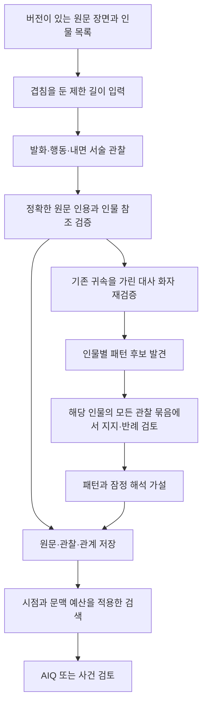

# 인물 기억: 원문 관찰, 패턴, 해석 가설

`prolog-ai` 0.1.0은 장면의 작은 발화·행동을 모아 인물별 반복과 반례를 검토하는
선택적 기억 계층을 제공한다. 기존 함수를 기억 없이 부르는 방식은 유지된다.
학습된 모델을 새로 만드는 기능은 아니며, 모델의 추출·해석 정확도는 실제 원고로 별도 평가해야 한다.

## 처리 구조



온톨로지는 Pydantic 스키마와 ID 참조로 표현한다. 별도 그래프 서버 없이 JSON/SQLite로 쓸 수 있다.

| 종류 | 보존하는 정보 | 의미 |
| --- | --- | --- |
| Character | ID, 이름, 별명 | 인물 식별. ASS 객체의 다른 필드는 자동으로 사실화하지 않음 |
| Scene | ID, revision, order, 원문, 선택적 chapter_id/story_time | 독서 순서와 작중 시간을 구분 |
| Observation | 인물, 상대, 발화/행동 종류, 맥락, 출처 | 확정/불확실한 주체를 구분. 단 한 번의 디테일도 남김 |
| Evidence | scene_id, revision, start, end, quote | Python 문자열의 0부터 시작하는 `[start:end]` 코드포인트 위치 |
| Pattern | 조건, 지지 관찰, 반례, 검토 범위 | 서로 다른 두 장면 이상이 지지해야 반복으로 승격 |
| Hypothesis | 패턴 ID, 해석, 다른 설명, tentative 상태 | 무의식의 확정 사실이나 의학적 진단으로 저장하지 않음 |
| CharacterMoment | 인지·반응·선택의 관찰, 잠정 해석, 대안, 반례 | 정독 결과. 반복 횟수와 무관하며 한 장면도 분석 가능 |

`presentation`은 `depicted`, `character_claim`, `narrator_claim`, `thought`를 구분한다.
정확한 인용이라는 사실만으로 그 인물의 주장이나 서술자의 말을 세계의 사실로 확정하지 않는다.
`attribution=uncertain` 관찰은 남기되 자동 패턴 합성에 쓰지 않는다.
대사는 추출기의 기존 인물 판정을 가리고 주변 원문으로 다시 검증한 뒤 패턴을 합성한다.
추출과 검증의 판정이 다르면 해당 대사의 정확한 앞뒤 문맥으로 재심한다. 같은 짧은 대사의
다른 출현 위치를 인용한 재심은 거부한다. 재심 모델은 코드가 잘라 둔 원문 선택지의 ID를
고르며, 코드는 그 선택지에서 인용·위치·동일 구절 순번을 복원한다. 다른 관찰의 ID는 사용할 수 없다. 불명확하거나 미등록인 화자는 불확실로 남긴다.
기존 확정 귀속과 검증이 충돌하면 모델의 다수결로 새 화자를 확정하지 않는다. 등록된 이름과
명시적인 발화 동사로 대조할 수 있을 때만 확정하고, 교대 대화 등 추론이 필요한 충돌은
`uncertain`으로 보존하여 패턴 합성에서 제외한다. 원문은 남아 있어 질문별 정독에서 다시 볼 수 있다. 수정 전 귀속, 판정 이유, 정확한 원문 근거는
`speaker_verifications`에 보존한다. `speaker_verification_version="v1"`이면 모든 저장 대사가
검증 기록을 가져야 한다. 이 필드가 없는 기존 기억은 읽을 수 있지만 검증 완료로 간주하지 않는다.
기존 기억을 `previous_memory`로 재구축하면 같은 추출 요청은 재사용하고 화자 검증을 새로 실행한다.
변경된 관찰을 사용하는 패턴 요청은 입력 캐시 키가 달라져 다시 계산한다.
이 과정도 모델 판정이며 화자의 의미적 정확성을 증명하지는 않는다.
`behavior_role`은 `trigger`, `awareness`, `desire`, `involuntary_reaction`, `choice`, `other`다.
인지·욕구·비의도성은 원문에 명시된 경우에만 관찰로 기록한다. 이전 기억의 이 필드가 없으면
`other`로 읽고, 변경된 추출 프롬프트의 캐시는 재사용하지 않는다.

패턴 후보는 작은 관찰 묶음에서도 발견할 수 있도록 단일 관찰을 씨앗으로 허용한다.
그 후 **모든 관찰 묶음을 다시 대조**한다. 동일 인물의 원문 관찰만 지지/반례로 쓸 수 있다.
반례가 있으면 패턴은 `contested`, 없으면 `recurring`이다. 이 표시는 심리 해석의 진실 확률이 아니다.
`evaluated_observation_count`는 검사한 관찰 수이며, 해당 상황이 발생한 총 횟수나 전체 원고의 재현율이 아니다.
정확히 같은 발화의 인물별/다른 인물 빈도를 분석에 전달하여 작가의 공통 문체 가능성도 고려하게 한다.

## 기본 사용

```python
from prolog_ai import run_character_memory, query_character_memory, run_aiq

characters = [
    {"character_id": "c1", "name": "서진", "aliases": ["진"]},
    {"character_id": "c2", "name": "서하"},
]
scenes = [
    {
        "scene_id": "scene-7", "revision": "1", "order": 7,
        "chapter_id": "chapter-7", "story_time": "부상 전",
        "text": "서하가 도와주겠다고 했다. 서진은 소매를 잡아당겼다. ‘됐어.’",
    },
    {
        "scene_id": "scene-31", "revision": "1", "order": 31,
        "text": "서하가 붕대를 꺼내자 서진은 손목을 소매로 가렸다. ‘별거 아니야.’",
    },
    {
        "scene_id": "scene-68", "revision": "1", "order": 68,
        "text": "서진은 서하에게 다친 손을 내밀었다. ‘네가 감아 줘. 부탁해.’",
    },
]
result = run_character_memory("project-1", scenes, characters)
if "error" in result:
    # 실패는 완료로 저장하지 않는다. checkpoint는 아래 방법으로 재개한다.
    raise RuntimeError(result["error"]["message"])
memory = result["data"]

# 원문이 포함된 제한 길이 검색. LLM 호출 없음.
context = query_character_memory(memory, "서진은 걱정을 받으면 어떻게 반응하나?", ["c1"])

# 기억 모드의 manuscript_text에는 현재 작업 구간만 전달한다. 빈 문자열도 허용한다.
answer = run_aiq(
    "서진이 도움을 거절하는 경향과 예외를 원문으로 설명해 줘.",
    "", memory=memory, memory_character_ids=["c1"],
)
```

기존 `USE_FAKE_LLM=1`도 지원하지만 빈 관찰 목록이 생성된다.
`memory.mode`는 `fake`/`real`이며 `memory.model`도 기록한다.
가짜 LLM 모드는 입출력 확인용이며 실제 말버릇을 발견했다는 증거가 아니다.

## 인지와 행동을 대조하는 정독·재검토

```python
from prolog_ai import run_character_reading

reading = run_character_reading(
    "인물이 아는 것과 실제 반응 사이에 차이가 있는가? 근거와 대안을 설명해 줘.",
    scenes, characters,
)
if "error" in reading:
    checkpoint = reading["error"]["details"].get("checkpoint")
    if checkpoint:
        reading = run_character_reading(
            "인물이 아는 것과 실제 반응 사이에 차이가 있는가? 근거와 대안을 설명해 줘.",
            scenes, characters, previous_analysis=checkpoint,
        )
```

첫 호출은 답변과 `moments`를 만들고, 두 번째 호출은 **동일한 원문 전체와 초안**을 받아
누락된 행동, 일반화, 주체·시점 혼동, 근거 없는 해석을 점검한다. 최종 답변은 `content`,
검토 메모는 `review_notes`, 최초 답변은 `draft`에 보존한다. 초안에 인용/인물 ID 오류가 있으면
`draft_reference_validation`에 표시하고 예정된 검토 호출에 오류를 알려 수정하게 한다.
최종 인용은 코드가 원문 위치와 대조하며, 수정되지 않은 인용이나 인물 ID 오류가 남으면
성공으로 반환하지 않는다. 오류가 있는 초안은 출처 검증을 통과한 최종 결과와 구별해야 한다.
정확한 인용은 해석의 타당성을 보장하지 않으며, 두 번째 모델 호출도 독립된 정답 판정자는 아니다.

입력 장면 원문 합계는 32,000자까지다. 초과 입력은 임의로 요약·절단하지 않고 거부한다.
결과의 범위는 항상 `coverage.scope=provided_source_windows_only`다. 최대 2회의 논리적 호출을
사용하며, 각 호출은 180초 timeout을 사용한다. 자동 재시도는 없으며 실패 시 체크포인트로
재개한다. `max_llm_calls=1`로 초안만 계산하면 완료 결과 대신 검토 대기 오류와 체크포인트를
반환한다. 원문·질문·인물·모델·추론 설정이 달라진 체크포인트는 거부한다.

`run_aiq(..., memory=...)`는 이 정독 경로를 기본 사용한다. 원문이 32,000자를 넘으면
세부 질문과 검색어를 분리하는 계획 호출을 한 번 추가한다. 출력 형식 지시는 검색어에서 제외한다.
관찰의 요약·인용과 원문 구간을 IDF 가중치로 검색하고, 세부 질문마다 관련 있는 앞뒤 시점을
확보한다. 반복 패턴에 들어가지 않은 일회성 원문도 검색 대상이다. 원문 발췌 합계는 같은
32,000자 한도이며 발췌끼리 겹치는 부분만 합친다. 따라서 한 장 전체를 읽었다는 뜻이 아니다.
`coverage.source_windows`의 원본 장면 ID와 `[start:end]`를 확인해야 한다.
최종 인용의 `scene_id/start/end`는 원본 위치로 복원하며 발췌 ID는 `excerpt_id`, 발췌 안에서의
동일 인용 순번은 `excerpt_occurrence`로 남긴다. 원본 구절을 생략 부호로 이어 붙이지 않는다.

`coverage.omitted_scene_ids`는 아예 읽지 않은 장면이고, 일부만 읽은 장면의 누락 범위는
`source_windows`로 확인한다. `as_of_order` 이후 원문과 그 시점 이후에 만든 패턴은 검색 계획에도
들어가지 않는다. 현재 원고와 이전 대화의 시점은 호출자가 맞춘다.
`review_character_details=False`는 기존 단일 호출 경로다.

검토 결과는 `coverage_checks`에 각 요구 번호와 그 요구에 답하는 최종 본문의 연속 문장을
제출한다. 빠진 번호, 본문에 없는 답, 닫히지 않은 인용/괄호, 콜론 등으로 끊긴 끝부분,
명시적인 `N자 이내` 제한 초과는 성공으로 반환하지 않는다. 이는 구조적 완결성 검사이며
모든 요구에 올바르게 답했다는 의미적 채점은 별도로 필요하다.
AIQ 실패의 `details.checkpoint`를 `previous_analysis`로 넘기면 검색 계획을 재사용한다.
잘못된 최종 답변의 오류와 본문도 수정 호출에 전달한다. 초안 실패는 초안부터, 검토 실패는
검토부터 재개하며, 초안의 잘못된 인용을 성공 답변으로 반환하지 않는다.
기본 호출 수는 짧은 원문 2회, 긴 원문 3회이며 각 호출은 180초 timeout, 자동 재시도 0회다.
검색 계획은 질문이 실제 요구한 비교를 최대 4개로 묶고 불필요한 세부 요구를 늘리지 않는다.
본문 작성 목표는 사용자의 글자 수 상한보다 짧게 잡되, 최종 검사는 실제 요청한 상한으로 한다.
긴 원고의 기억 검색 경로는 원문 문단에 요청별 근거 ID를 붙여 전달한다. 모델은 인용문을
다시 쓰는 대신 ID를 선택하고, 코드는 해당 구간의 원문·revision·원본 위치를 복원한다.
동일한 문장이 여러 번 나와도 선택한 구간의 위치를 사용한다. 모르는 ID는 거부한다.
요구별 `answers.text`를 순서대로 최종 `content`에 넣고 `coverage_checks`도 같은 문장에서
만든다. 따라서 점검표와 본문의 복사 불일치를 피하면서 누락·중복 요구, 끊긴 문장,
전체 글자 수를 검사한다. ID가 정확하다는 사실은 인물 해석이나 답변 의미의 정확성을 보장하지 않는다.
입력에는 원문을 한 번만 싣고 불필요한 장면 메타데이터를 제외한다. 짧은 문단이 너무 많으면
같은 발췌 안의 인접 문단만 묶으며 원문을 생략하거나 서로 떨어진 구절을 이어 붙이지 않는다.
짧은 원고와 직접 `run_character_reading` 호출은 기존 연속 인용 방식과 반환 계약을 유지한다.
정독의 `moments`는 반환 결과이며 `MemoryStore`에 자동 병합하지 않는다. 원문 관찰의 역할은
기억에 저장되지만, 질문별 잠정 해석을 영구 설정이나 반복 패턴으로 자동 승격하지 않는다.

## 분량, 비용, 재개

`run_character_memory(project_id, scenes, characters, previous_memory=None, *,
chunk_chars=6000, batch_chars=12000, max_llm_calls=200)`:

- `scenes`는 **현재 원고의 전체 장면 목록**이다. 빠진 장면은 삭제한 것으로 처리한다.
  장면 ID와 order는 중복할 수 없다. `revision`은 문자열이다.
- 제목 정규식에 의존하지 않고 백엔드의 명시적 장면 경계를 받는다.
- 긴 장면은 겹치는 조각으로 모두 읽는다. 원문을 요약본으로 교체하지 않는다.
  원문에 정확히 존재하지 않는 인용과 모르는 인물 ID는 버리고 `meta.removed_observations`로 센다.
- 각 요청은 최대 32,000개의 직렬화된 문자로 제한한다. 이는 **토큰 한도가 아니다**.
  `chunk_chars`는 1,000~8,000, `batch_chars`는 4,000~16,000이다.
- `max_llm_calls`는 1~10,000의 논리적 호출 예산이다. 기억 구축은 호출당 180초 timeout과
  최대 1회 재시도를 사용한다. 재시도는 논리적 호출 예산과 별도다.
  전체 작업의 시간 제한이 아니므로 워커에서 실행한다.
- 후보 수가 많아지면 재검토 비용도 늘어난다. 관찰 묶음 수를 B, 후보 묶음 수를 P라 하면
  재검토는 P×B 요청이다. 예산이 끝나면 성공으로 위장하지 않고 `AI_ANALYSIS_FAILED`와
  `details.internal_code=CALL_BUDGET_EXCEEDED`를 반환한다.
- 실패한 요청 이전의 응답은 `details.checkpoint.call_cache`에 보존한다. 원문 인용 검증을
  통과한 완료 장면의 관찰만 checkpoint에 보존한다. 불완전한 기억으로 AIQ/검토를 할 수 없다.

```python
previous = None
while True:  # 실제 워커에서는 실행 횟수와 작업 종료 정책도 둔다.
    result = run_character_memory(
        "project-1", scenes, characters, previous_memory=previous, max_llm_calls=10,
    )
    if "data" in result:
        memory = result["data"]
        break
    details = result["error"]["details"]
    previous = details.get("checkpoint")
    if details.get("internal_code") != "CALL_BUDGET_EXCEEDED":
        # 인증·입력·모델 형식 오류를 무한 재시도하지 않는다.
        raise RuntimeError(result["error"]["message"])
```

원문·인물 목록·모델·프롬프트·설정이 같은 요청은 재실행하지 않는다. 원문 수정/장면 삭제 후에는
현재 자료로 관찰과 관계를 다시 구성하고, 동일한 요청만 캐시를 재사용한다. 따라서 기존 가설이
새 원고와 무관하게 남지 않는다. revision을 올리지 않은 텍스트 수정도 캐시 키와 관찰 ID를 바꾼다.
그래도 백엔드에서는 revision을 갱신해야 사용자가 출처 버전을 이해할 수 있다.

## 저장

호출 결과의 `data`와 실패 시 `checkpoint`는 JSON으로 저장할 수 있다. 백엔드 DB에 직접 저장하거나
로컬 SQLite 저장소를 사용할 수 있다. API 키는 저장하지 않는다. 저장 데이터에는 원문이 들어 있다.

```python
from prolog_ai import MemoryStore

with MemoryStore("character-memory.sqlite3") as store:
    saved = store.load("project-1")
    result = run_character_memory(
        "project-1", scenes, characters,
        previous_memory=saved["memory"] if saved else None,
        max_llm_calls=10,
    )
    candidate = result.get("data") or result.get("error", {}).get("details", {}).get("checkpoint")
    if candidate is not None:
        store.save(candidate, expected_revision=saved["revision"] if saved else 0)
```

`MemoryStore.load`는 없으면 `None`, 있으면 `{"revision": int, "memory": ...}`를 반환한다.
`save`는 원문/관계 무결성을 검사하고 하나의 트랜잭션으로 저장한다. 다른 작업이 먼저 갱신했으면
`ValueError`가 나므로 다시 읽고 판단해야 한다. 파일·SQLite 오류도 호출자가 처리한다.
저장소 클래스는 `run_*` 함수의 에러 봉투 계약에 포함되지 않는다.

## 시점과 검색 범위

`query_character_memory(memory, query, character_ids=None, *, as_of_order=None,
max_context_chars=16000)`는 인물 필터, IDF 가중 한국어 글자 쌍/세 글자 검색,
패턴의 근거 연결을 사용한다. 개별 관찰에 먼저 문맥 예산을 예약하여 일반적인 패턴이
일회성 디테일을 밀어내지 않게 한다. 이 함수 자체는 LLM을 호출하지 않는다.
현재는 외부 임베딩이나 벡터 DB를 사용하지 않는다. 인물 ID를 명시하면 동명이인/별명 검색의
불확실성을 줄일 수 있다. `character_ids=[]`는 인물을 선택하지 않는다는 뜻이다.

- 결과에 관찰 원문과 앞뒤 120자의 문맥을 함께 싣는다.
- 근거가 많은 패턴은 장면과 독서 순서를 고려하여 지지/반례의 대표 인용을 선택한다.
  서로 다른 두 지지 장면, 반례가 있으면 최소 한 반례를 함께 넣으며 선택/생략량을
  `evidence_selection`에 표시한다. 전체 근거 수와 제공된 인용 수를 구분해야 한다.
  최소 묶음도 예산에 안 맞으면 패턴/가설을 빼고 개별 관찰을 반환한다.
- `coverage.truncated`, `omitted_pattern_count`, `sampled_pattern_count`, 관찰 수를 확인한다.
  `coverage.exhaustive`는 항상 false다. 전 장면을 호출했어도 추출 누락 가능성이 있기 때문이다.
- `as_of_order=31`이면 31까지의 장면만 검색한다. 이후 장면까지 검토하여 만든 패턴/가설은
  지지 인용이 과거에 있더라도 반환하지 않는다. 과거 시점의 패턴이 필요하면 그 시점까지의
  장면으로 별도 기억을 구축한다. 스포일러 제한은 인물 목록/현재 원고/대화 자체에는 적용되지 않으므로
  호출자가 그 입력에도 미래 정보를 넣지 않아야 한다.
- AIQ 기억 모드의 현재 구간·질문·대화·선택 구간은 합계 8,000자의 직렬화 예산이다.
  전체 원고를 재전송하지 않는다. 답변 형식은 기존 `data.content`를 유지한다.

## SCDS와 사건 검토

```python
from prolog_ai import run_character_review, run_scds

event = {"character_ids": ["c1"], "content": "서진은 서하에게 먼저 도움을 청했다."}
review = run_character_review(event, memory)
combined = run_scds(event, world_rules=[], characters=characters, memory=memory)
```

기억 검토는 세계관 키워드 후보가 없어도 실행된다. 결과는 `findings`와 `coverage`이며,
각 판단은 다음 종류 중 하나다.

- `continuation`: 기존 경향과 이어짐
- `development`: 관계·상황·성장에 따른 변화 가능성
- `possible_inconsistency`: 원문 근거가 있는 불일치 후보
- `insufficient_evidence`: 판단 근거 부족

판단에는 사건의 정확한 `event_quote`, 같은 인물의 기존 `observation_ids`, 원문 `evidence`가 필요하다.
없는 인용/관찰이나 불확실한 주체의 관찰을 근거로 삼으면 버린다. 아무 결과가 없다는 것이
모순이 없다는 증명은 아니다. 모델의 의미적 해석까지 코드로 증명하지는 못한다.

`run_scds(..., memory=...)` 또는 `run_scds_analysis(..., memory=...)`를 쓰면 결과의
`data.character_review`에 별도로 담고 성공 시 `data.status=completed`가 된다.
세계관 `conflicts`와 인물 변화 검토를 합치지 않으며, 패턴 ID를 `world_rules.rule_id`로 저장하지 않는다.
세계관 후보가 없어서 기억만 검토한 경우 `conflicts=[]`를 반환한다.
`run_scds_rules`는 기존대로 LLM을 호출하지 않는다. **기억 검토를 원하는 백엔드는 rules의
status가 skipped여도 워커를 실행**하거나 `run_character_review`를 별도로 호출해야 한다.
기억 검토 실패 시에도 `error.details.rule_result`에 세계관 후보가 남는다.

## 검증과 남은 한계

```bash
USE_FAKE_LLM=1 .venv/bin/python -m pytest -q
.venv/bin/ruff check .
.venv/bin/python -m evals.memory_bench.run_bench
# 실제 API 비용 발생. 선택한 제공사의 API 키를 설정한 뒤 실행한다.
.venv/bin/python -m evals.memory_bench.run_bench --real --output /tmp/memory-evaluation.json
# NVIDIA_API_KEY가 설정된 경우 Step 5로 실행
PROLOG_AI_PROVIDER=nvidia PROLOG_AI_MODEL=stepfun-ai/step-5-preview \
  .venv/bin/python -m evals.memory_bench.run_bench --real --output /tmp/step5-memory.json
# 원거리 단서 사이에 방해 장면을 늘리는 평가
.venv/bin/python -m evals.memory_bench.run_bench --real --distractor-scenes 100 --max-calls 300
```

벤치마크는 이 저장소를 위해 작성한 짧은 창작 문장이다. 관찰 회수, 주체 오판, 서로 다른 장면의
지지/반례 연결을 검사한다. 심리적 동기의 타당성과 실제 장편에서의 회수율은 사람의 주석과
추가 원고로 평가해야 한다. 가짜 LLM 실행은 품질 평가로 표시하지 않는다.
일반 `evals/run_evals.py`도 이제 AI 실패 응답을 PASS로 처리하지 않는다.

### NVIDIA Step 5 실제 실행 (2026-10-22)

모델은 `stepfun-ai/step-5-preview`, `temperature=1.0`, `top_p=0.95`,
출력 한도 16,384토큰, 요청 제한 90초, 최대 재시도 2회다. 짧은 한국어 창작 장면 4개로
구성된 기존 평가 2건을 실행했다. 장편이나 100만 토큰 입력의 성능을 측정한 것은 아니다.

| 항목 | 결과 |
| --- | --- |
| 단순 연결/도구 호출 확인 | 성공, 2.33초 |
| 기록된 평가 요청 (재시도 포함) | 9회: 응답 2회, 시간 초과 7회 |
| 성공한 추출 요청 시간 | 12.05초, 85.34초 |
| 요청 소요 시간 합계 | 728.21초 (재시도 대기와 초기 진단 제외) |
| 끝까지 완료한 평가 | 0/2. 두 평가 모두 `AI_ANALYSIS_TIMEOUT` |
| 일부 완료된 추출 | s7·s31에서 관찰 8개, 이 두 장면의 지정 디테일 4개 모두 회수 |
| 지지/반례 패턴 및 심리 가설 | 해당 단계에 도달하지 못해 미검증 |
| 화자 불명·단발성 디테일 사례 | 추출 시간 초과로 미검증 |

회수한 디테일은 소매를 잡아당기는 행동, 손목을 소매 속으로 감추는 행동, “됐어”,
“별거 아니야”다. 이후 도움을 청하는 s68은 세 번 모두 시간 초과로 실패했다.
따라서 이 결과를 인물 변화 이해나 무의식 해석의 성공으로 계산하지 않는다.
원인이 모델 추론, 제공사 대기, 네트워크 중 어느 쪽인지는 이 기록만으로 확정할 수 없다.

[원본 결과·요청 시간·usage·재개 checkpoint](../evals/memory_bench/results/step5-2026-10-22.json)를
보존했다. 토큰 수는 성공한 응답에서 보고된 입력 2,399·출력 790이며, 시간 초과 요청의
사용량과 과금은 알 수 없다. 기록 전 중단한 초기 진단은 평가 요청 통계에 포함하지 않았다.
API 키는 결과나 저장소에 저장하지 않았다. 첫 사례의 checkpoint로 재개하면 완료된
두 장면의 추출 캐시를 재사용할 수 있다.

현재 판단은 **연결과 일부 디테일 추출은 확인했으나, 이 엔드포인트의 호출 안정성과
전체 해석 품질은 채택 근거가 부족하다**는 것이다. StepFun의 공식 모델 카드는
[긴 문맥·도구 사용·전문 지식 작업](https://huggingface.co/stepfun-ai/Step-5-Preview)을 강조하며,
소설 해석 특화의 증거로 대신 사용할 수는 없다.

모델이 처음부터 관찰을 놓치면 온톨로지에 남지 않는다. 원문은 남으므로 새로운 분석으로 재탐색할 수 있다.
이를 강제로 다시 실행하려면 `previous_memory`를 생략하거나 캐시를 비워 새로 구축한다.
여러 묶음에서 같은 의미의 후보를 다른 표현으로 만들 수 있으며 현재는 표현이 같은 후보만 합친다.
이 경우 의미 중복 패턴과 추가 호출 비용이 생길 수 있다. 검색에도 의미적 동의어 회수 한계가 있다.
원고 전체 인과관계를 구성하는 SSM의 기존 챕터 단위 구조는 이 변경에서 교체하지 않았다.

## NVIDIA GLM 5.3 Flash 재검증 (2026-10-22)

기본 모델을 `z-ai/glm-5.3-flash`로 전환했다. NVIDIA 문서의 추론 설정 `low`와
`clear_thinking=true`를 보내고 스트리밍 도구 호출을 사용한다. 아래는 개인 원고의
실측이며 원문과 응답은 공개 저장소 밖에 보관했다. 단일 시행의 시간으로 장기 안정성이나
일반적인 문학 분석 성능을 추정하지 않는다.

| 시험 | 관찰된 결과 |
| --- | --- |
| 동일한 세 장·동일 질문의 단일 답변 | GLM 7.03초. 이전 Step 5는 139.67초 |
| 세 장 정독·재검토 개발 시험 | 2회 호출, 합계 66.84초. 비의도적 반응과 뒤이은 선택을 답변에서 연결 |
| 전체 18장·99,015자, 질문 8개 직접 평가 | 199.22초에 응답 완료. 구조화 인용 29개 중 26개만 정확한 연속 원문과 일치해 기계 검증은 실패 |
| 원문의 네 발췌 1,026자 기억 구축 | 8회 호출, 159.21초. 출처를 검증한 관찰 24개, 반복 패턴 4개, 잠정 가설 4개 |
| 저장된 네 발췌 기억을 사용한 AIQ | 2회 호출, 152.06초. 검토 단계가 초안의 잘못된 인용 순번을 수정하고 최종 출처 검증을 통과 |

전체 원고 시험은 정독 파이프라인과 별도인 단일 요청 평가다. 일부 인용의 생략·합침 외에
미확정 정보를 확정한 답변도 발견돼 의미 정확도를 통과한 것으로 취급하지 않는다.
정독 시험도 같은 사례를 보고 프롬프트를 보완한 개발용 평가이므로 별도 장면/작품의 검증이
필요하다. 재검토 모델은 오류를 놓치거나 새 오류를 만들 수 있다. 인용의 일치 여부와
해석의 타당성은 별도로 확인한다. 네 발췌의 기억 구축 완료는 전체 원고 색인 완료를 뜻하지 않는다.

## 전체 기억 구축과 동일 14문항 재시험 (2026-10-26)

개인 원고 전체 18장·99,015자로 기억을 구축하고 같은 14문항과 사전 지정 근거 52개로
이전 구현과 최종 구현을 비교했다. 모델은 NVIDIA `z-ai/glm-5.3-flash`, 추론 설정은 `low`다.
질문당 원문 예산은 32,000자, 답변 지시는 800자 이내, 최대 시도는 2회, 동시 질문은 2개다.
최종 구현은 실제 글자 수 제한도 검사한다. 정답과 지정 근거는 생성 모델에 전달하지 않았다.

| 항목 | 이전 | 최종 |
| --- | --- | --- |
| 답변 완료 | 11/14 | 14/14 |
| 완전 통과 / 부분 통과 / 의미 오답 / 미완료 | 1 / 6 / 4 / 3 | 4 / 5 / 5 / 0 |
| 지정 근거가 실제 정독 입력에 포함됨 | 18/52 | 37/52 |
| 구조화 인용의 원문 위치 일치 (중복 포함) | 199/199 | 357/357 |
| 질문 평가 API 실패 / 논리 호출 | 4/31 | 0/42 |
| 질문 평가 전체 소요 시간 | 18분 6초 | 12분 17초 |

최종 14문항은 모두 첫 시도에 완료됐다. 긴 원고의 검색 계획·초안·검토에 각각 14회,
총 42회 호출했다. 이는 단일 실행의 관찰이며 장기 API 안정성이나 일반적인 정확도가 아니다.
의미 채점은 작성 도구가 고정 기준과 원문을 대조한 수동 검토이며 독립된 사람 평가가 아니다.
같은 작품을 반복 개발한 평가로, 별도 작품에 대한 검증도 필요하다. 앞선 개발 시험의
완료 수는 각각 0/14와 8/14였으며 최종 결과와 골라 합치지 않고 별도로 보존했다.

전체 기억에는 관찰 1,798개, 패턴 400개, 잠정 가설 382개가 저장됐다. 대사 733개를
검증하고 85개를 국소 재검토했다. 알려진 잘못된 화자 귀속 2개는 불확실로 낮춰 패턴에서
제외했으나 올바른 화자를 확정한 것은 아니다. 대사 전체의 의미 정확도는 미검증이다.
정독 입력에 근거가 있어도 전환점을 빠뜨리거나 인물·시점을 섞고, 본문과 구조화 분석이
서로 모순되는 사례가 남았다. 인용 일치와 답변 완료를 해석의 정답률로 사용하면 안 된다.

기억 코드 고정 후 구축 완료까지 약 4시간 31분이 걸렸다. 유효 요청 151개를 재사용하고
새 유효 요청 480개를 처리했으며, 해당 구간 논리 호출은 502회였다. API 실패 16개와
근거 ID 오류 6개는 재요청으로 복구했다. 오케스트레이션 대기와 캐시 재사용이 포함돼
이전 구축 속도와 직접 비교할 수 없다. 전체 테스트 437개와 SQLite 저장·재읽기 검증은 통과했다.
원문·전체 응답·SQLite·개발 실행 기록은 공개 저장소 밖에 보관하고 집계만 여기에 기록한다.

## 설계 참고

- [PersoNet: Personality Understanding of Fictional Characters during Book Reading](https://aclanthology.org/2023.acl-long.826/): 문맥에 따라 달라지는 인물 해석.
- [NoLiMa](https://arxiv.org/abs/2502.05167): 긴 문맥에서 직접 표현이 일치하지 않는 근거 연결의 한계.
- [GraphRAG 검색 구조](https://microsoft.github.io/graphrag/query/overview/): 관계와 원문을 함께 검색하는 접근.

이 구현은 해당 프로젝트들의 코드나 성능을 재현했다고 주장하지 않는다.

## OpenAI 백엔드의 통합 처리 경로

`memory.compact`는 기존 공개 `run_character_memory` 함수를 변경하지 않는 별도 경로다.
백엔드 `PrologAI`의 OpenAI 경로가 이를 사용하고, 다른 제공사는 기존 경로를 유지한다.

- v3는 최대 2장 / 본문 12,000자씩 묶고 기본 9묶음을 병렬 처리한다. 백엔드의
  `CHARACTER_MEMORY_CONCURRENCY`로 1~9를 설정한다. 추출에 누락이 없는 묶음은
  다른 묶음의 추출 완료를 기다리지 않고 독립 검증을 시작한다. 누락은 여러 묶음에서
  모아 보완하고, 검증된 기록의 주체 재검토는 다시 최대 9묶음을 동시에 처리한다.
  모든 묶음이 검증된 뒤 인물 등록과 전체 종합을 수행한다. 실패 시 새 요청은
  멈추고 진행 중인 요청의 사용량과 결과를 저장한 뒤 실패 처리한다. 취소도 진행 중인
  유료 요청을 버리지 않고 마무리한다. 원문은 문장 경계/최대 180자로 나누고, 경계 앞뒤
  2개 원문 단위는 문맥으로만 제공한다.
- 인물/별칭 발견과 발화/행동 추출을 한 요청에서 수행한다. 이름을 포함한 실제 근거만
  등록하며, 별칭과 정체가 불분명한 호칭은 기존 작가 확인 절차를 유지한다.
- 모델은 인물/원문 번호와 분류 코드를 숫자 배열로 반환한다. 인용·위치·표시용 요약과
  문맥은 서버에서 복원한다. 한 문장의 여러 인물/종류는 별도 행으로 남긴다.
- 실제 기록 또는 배경 제외 판단이 없는 원문 단위를 감지해 전체 묶음의 누락을 합쳐
  요청한다. 이미 유료 보완 응답이 저장돼 있으면 먼저 재사용한다. 남은 누락만 최대
  2회 보완하며, 한 통합 보완에 1,500개를 넘는 대상이 있으면 유료 요청 전에 중단한다.
  통합 요청의 원문/관찰 번호를 원래 묶음의 번호로 되돌린 뒤 원문 위치를 다시 검증한다.
  `must_record_ids`로 명시적 대사/습관/신체 반응의 제외 금지를 입력에도 알린다.
  명시된 대사/습관 등을 배경으로 제외한 경우도 보완 대상이다. 보완 후에도 빠진 단위가
  있으면 완료 처리하지 않는다. `covered_units`라는 자기 보고만으로 누락 검사를 통과하지 않는다.
- 묶음마다 독립 검증으로 발화뿐 아니라 행동/내면/특징의 실제 주체를 확인한다.
  추출기의 주체와 분류는 검증기에 공개하지 않는다. 발화 판정 불일치는 `uncertain`으로
  남긴다. 비발화의 주체가 충돌하면 그 기록만 묶음당 최대 1회 독립 재검토하며,
  두 검증이 같은 인물로 확정한 경우만 수정한다. 정체를 확인하는 장 전체 문맥은 유지한다.
  검증 근거는 시작 원문 번호와 문장 수(1~8)로 반환받아 서버에서 끝 번호를 계산한다.
  1차 검증 응답에서 빠진 관찰 번호나 잘못된 근거도 묶음들을 합쳐 해당 기록만 최대 2회
  보완한다. 성공한 판정은 재사용하고, 보완 후에도 번호가 누락되면 완료하지 않는다.
  보완 요청에도 동일 장 전체 문맥을 유지한다. 모든 보완과 재시도는 40회 상한 안에 포함된다.
  축약 이름은 추출의 별칭 후보와 독립 검증이 일치하고 동명이인 충돌이 없을 때만
  해당 묶음에서 연결한다. 작가의 별칭 목록은 자동으로 변경하지 않는다.
  검증 응답의 근거 범위가 너무 길면 해당 기록의 주체는 `uncertain`으로 보류하고,
  원래 잘못된 근거 행을 감사 기록에 남긴다. 잘못된 별칭 대상/인용은 정체 연결을
  확정하지 않는다. 참고용 문맥을 skip에 적은 경우에는 감사 기록에만 남기고 본문
  처리 범위로 계산하지 않는다. 실제 입력에 없는 번호는 계속 거부한다.
  떨어진 근거 문단을 반환하면 실제 사이 원문을 포함해 하나의 인용으로 합치되,
  같은 장면·최대 인용 길이·대사 주변 범위 검증은 그대로 적용한다. 원래 근거 ID도
  감사 기록에 보존하며 화자 판정 자체를 수정하지 않는다.
- 전체 확정 관찰을 모아 패턴 후보 제안/지지·반례 검토를 최대 2회 수행한다.
  후보는 최대 64개이며 상세 관찰은 후보 선정 여부와 관계없이 보존한다.
  후보가 다른 인물/없는 관찰 번호를 인용하면 해당 근거를 제거하고 원래 응답을 감사
  기록에 남긴다. 유효 근거가 남지 않는 후보는 보류하며, 나머지도 독립 검토를 거쳐야 한다.
  최종 검토의 잘못된 지지 근거는 제외하고, 반례 근거 오류나 지지/반례 충돌이 있으면
  해당 결론 전체를 보류한다. 반례 오류를 지워 '반례 없음'으로 확정하지 않는다.
  반복된 원문/문맥을 한 번만 보내는 문자열 표를 사용하며, 모든 확정 기록의 번호를 유지한다.
  두 종합 요청은 같은 도구 스키마와 공통 기록을 먼저 보내고 작업/후보를 뒤에 붙인다.
  OpenAI GPT-6/5.6 경로는 공통 기록에 명시적 캐시 경계를 지정해 재사용하고, 변하는
  뒤쪽 내용에는 캐시 쓰기 비용을 발생시키지 않는다. 다른 모델/제공사는 기존 요청 형식을
  유지한다. 캐시 적중은 제공자 사용량으로 확인해야 하며 입력 재사용이 출력 생성 시간을
  줄인다는 보장은 없다. 종합 입력 형식 버전만 별도 관리하므로 기존 추출/검증 캐시는 유지된다.
  근거: [OpenAI prompt caching](https://developers.openai.com/api/docs/guides/prompt-caching).
- 이 경로의 출력 예산은 32,768토큰이다. 기존 모듈은 16,384를 유지한다.
  OpenAI의 엄격한 출력 스키마를 적용한다. 불완전 응답은 완료 처리하지 않는다.
  원문과 일치하지 않는 개별 관찰은 확정 기억에서 제외하고 원래 응답과 이유를
  `validation_audit`에 보존한다. 제외량이 3건 또는 전체 관찰의 10% 중 큰 값을
  넘으면 작업을 중단한다. 보완/주체 재검토도 동일한 물리 요청 한도를 사용한다. 일부 관찰의 제외 여부와
  원문 전체의 의미적 추출 품질은 별도로 확인해야 한다.

백엔드가 `RequestPolicy`를 설치해야 모델 요청을 보낼 수 있다. 요청 직전 DB에 횟수를
예약하므로 SDK 재시도, 작업 재시작, 수동 재시도도 같은 한도를 쓴다. **작업당 물리 요청
40회, 동일 단계/입력당 2회**를 넘기지 않는다. 저장 직후 프로세스가 죽으면 미전송 예약이
남을 수 있으나, 이를 환급해 중복 과금을 유발하지 않는다. 요청 생성 API를 반복해도 같은
실패 스냅샷에는 새 예산을 주지 않는다. 원고 변경으로 새 분석을 만들면 새 예산을 갖는다.

정상 계획은 `2 × 묶음 수 + 2`로 보수적으로 산정한다. 20단계를 넘는 원고는 유료 요청
전에 중단한다. 현재 상한은 잿빛 등불 규모에 맞춘 비용 제한이며 모든 길이의 소설을
40회 안에 완료한다는 보장이 아니다. 기록이나 패턴 후보가 없으면 호출은 줄어든다.
9묶음의 새 분석은 기본 20회이며, 통합 추출 보완 2회·통합 검증 보완 2회·묶음별
주체 재검토 9회를 모두 포함하면 논리 요청은 최대 33회다.
재시도까지 포함한 물리 요청 상한은 여전히 40회다.

완료 단계는 원문, 문맥, 기존 인물 이름/별칭, 모델/추론 설정, 파이프라인 버전으로 캐시한다.
인물 정보가 같다면 수정된 장면과 경계 문맥을 참조하는 묶음 및 종합 결과만 다시 계산한다.
최초 자동 발견으로 인물이 추가된 뒤에는 새 이름 힌트가 관련 묶음의 캐시를 무효화할 수 있다.
같은 작업을 재개할 때는 최초 이름 목록을 유지한다. 호출 횟수와 제공사의
입력/출력/추론/캐시 토큰을 작업 결과에 보존한다. 토큰 집계는 청구서가 아니다.

오프라인 계획/근거 재생 검증:

```sh
python evals/plan_compact_memory.py /path/to/saved-memory.json
```

잿빛 등불 기존 스냅샷(18장, 98,749자)은 9묶음, 정상 최대 20회로 계획된다.
v1의 원문 단위 1,766개와 기존 관찰 근거 2,319개를 실제 원문 좌표로 복원해 확인했다.
v2는 같은 원고를 4,551개의 더 작은 원문 단위로 나눈다.
이는 저장/복원 및 호출 계획 검증이며, 새 추출의 재현율·정확도·비용·시간 실측이 아니다.

### 잿빛 등불 v1 통합 경로 실측 (2026-11-16)

동일한 18장·98,749자 원고를 실제 백엔드 처리기로 완료했다. Luna 추출/화자 검증
20회(실제 재요청 2회 포함), Terra 종합 2회로 총 22회였다. 제공사 집계 입력
513,426토큰, 출력 186,245토큰이며 캐시 쓰기/읽기를 반영한 표준 단가 환산은
$0.377564985다. 청구서 확정 금액은 아니다. API 응답 대기 합계는 19분 34초,
검증 오류 수정과 재개를 포함한 전체 경과 시간은 26분 50초였다.

관찰 2,123건, 독립 화자 검증 838건, 반복/변화 패턴 39건과 잠정 가설 39건을
저장했다. 원문 불일치 관찰 17건은 제외해 감사 기록에 남겼다. 확정 인물 연결이
없는 관찰은 1,039건이다. 특히 축약 호칭의 연결 실패와 한 묶음의 후반 추출 누락이
확인되어, 낮은 비용을 같은 품질을 유지한 최적화의 증거로 해석해서는 안 된다.

개발용 원문 기준 사례 9개 중 근거 저장은 7개, 올바른 인물 확정 연결은 6개였다.
기존 Terra 저장 스냅샷은 각각 8개/6개였지만 미완료 스냅샷이므로 통제된 모델 비교가
아니다. 7장의 사과와 1장의 휘파람 근거가 누락됐다. 후자의 버릇 자체는 다른 장의
기록에서 패턴으로 포착했다. 전체 의미 정확도·재현율, 세계관 충돌 검사 및 브라우저
E2E 검증 결과로 확대 해석할 수 없다. 완료된 동일 원고 재요청이 같은 작업을
반환하고 새 API 호출을 만들지 않는 것도 실제 DB에서 확인했다.

### v2 개발 검증 범위

1·7·11장 표본과 회상 속 습관 묘사 세 문장을 실제 API로 시험했다. 개발 도중 받은
응답을 재사용했으며 총 15회, 제공사 사용량 기준 $0.022072였다. 세 장 추출 요청의
응답 대기 합계는 71.7초, 동시 실행 경과는 26.4초였다. 전체 18장 처리 시간은 아니다.
추출 출력은 동일 기록의 일반 JSON 확장 형식보다 UTF-8 크기가 86.8% 작았다.
이는 출력 토큰이나 청구액의 감소율이 아니다.

7장의 사과 누락은 복구됐다. 회상자의 내면과 다른 사람의 습관 묘사를 나누도록
분류/검증을 수정했으나, 별도 세 문장 검사에서 '어머니'와 '서하린'의 정체 연결은
독립 판정이 갈려 불확실로 남았다. 11장의 목소리 부재 서술에도 인물 귀속 보류가
남는다. 수정 과정의 표본 결과들을 완성된 전체 분석의 정확도로 합산하지 않는다.
새 파이프라인의 전체 18장 기억 구축과 최종 패턴 품질은 아직 재측정하지 않았다.


### v2 전체 18장 실행: 병렬 처리와 캐시 적용

2026-11-16, 같은 원고 18장/98,749자로 실제 백엔드 처리 경로를 끝까지 실행했다.
화면 조작을 통한 E2E 측정은 아니다. 6묶음 병렬 처리, 추출 직후 검증, 누락된 판정만
보완, 공통 종합 입력의 명시적 캐시를 적용했다.

- 실제 처리기 실행 시간 합계 **373.681초(6분 14초)**. 개발 중 네 차례 수정/재개를 포함한
  전체 경과 시간은 **1,093.339초(18분 13초)**. 6분 14초는 무중단 초기 분석 벤치마크가
  아니며, 다음 실행의 완료 시간을 보장하지 않는다. 이미 과금된 응답을 재사용해 복구했다.
- 실제 요청 **40회/상한 40회**: 추출 18회(9묶음+누락 보완 9회), 검증 20회(기본 9회,
  주체 재검토 9회, 누락/근거 보완 2회), 종합 2회. HTTP 재전송 없이 유료 응답을 복구했다.
  이 실행은 호출 상한을 모두 사용했으므로 추가 재시도 여유는 없었다.
- 사용량: 입력 **710,273**, 출력 **99,810**토큰. 종합 검토에서 **124,896** 입력 토큰을
  캐시로 재사용했다. 입력 재사용은 확인했지만 출력 생성이 빨라진다는 뜻은 아니다.
- 응답 사용량과 공식 Standard 단가로 계산한 비용 **$0.310660225**. 이전 v1 전체 실행의
  **$0.377564985**보다 약 **17.7%** 낮다. 청구서 확정액이 아니며, 동시에 바뀐 출력 형식,
  관찰 단위/검증 범위와 병렬 처리가 있으므로 동시성 하나만의 A/B 결과는 아니다.
- 관찰 **3,895개**, 화자 검증 **1,458개**, 패턴/가설 각각 **32개**. 모든 인용이 원문
  위치와 일치함을 확인했다. 주체 불확실 기록은 **732개**로 그대로 남긴다.
- 기존 확인 구절 9개 중 **9개 포착**, **8개 기대 인물에 확정 연결**. v1은 각각 7/9,
  6/9였다. 하린의 휘파람 버릇과 윤하의 사과를 회수했고, 11장의 '휘파람 소리는 없었다'는
  주체 불확실로 유지했다. 이 작은 회귀 집합은 전체 정확도 평가가 아니다.

단가 출처: [Luna](https://developers.openai.com/api/docs/models/gpt-6-luna),
[Terra](https://developers.openai.com/api/docs/models/gpt-6.1-terra).


### 후속 무중단 재측정: 완료 시간 미확정

같은 18장/98,749자를 앱 결과 캐시가 빈 새 작업으로 재실행했다. 이 요청의 시도별 결과:

| 시도 | 경과 시간 | 결과 | 사용량 기준 추정 비용 |
| --- | ---: | --- | ---: |
| 1 | 46.615초 | 분류 코드 오류로 중단 | $0.028382050 |
| 2 | 76.266초 | 존재하지 않는 인물 번호로 중단 | $0.024082205 |
| 3 | 273.502초 | 마지막 종합 검토에서 크레딧 부족 | $0.275536380 |

첫 두 실패 사이에 응답 검증을 보완했다. 잘못된 분류/인물/청자 번호를 임의 해석하거나
조용히 삭제하지 않고 해당 원문 단위를 보완 대상으로 남긴다. 다른 유효 기록이나 skip이
같은 단위를 포함해도 보완을 생략하지 않으며, 보완 응답도 틀리면 완료를 거부한다.

세 번째 실행은 실행 도중 코드 변경/수동 재개 없이 4분 33.502초간 진행됐다. 18장 처리,
관찰 3,898개, 화자 검증 1,462개와 종합 후보 생성까지 저장했지만, 마지막 검토 요청이
HTTP 429 `credit_balance_exhausted`로 거절됐다. 자동 재시도도 같은 이유로 거절되어
40회 호출 상한에 도달했다. **전체 완료가 아니므로 4분 33초를 완료 시간으로 인용하지 않는다.**
이 요청의 세 시도를 합친 추정 비용은 **$0.328000635**이며, 잔액 조회나 확정 청구액이 아니다.

측정 종료 후 크레딧/사용 한도 오류를 일반 속도 제한과 구별하여 자동 재시도하지 않도록
수정했다. 저장된 결과와 기존 작업의 호출 상한은 유지했다. 제공자 입력 캐시는 활성화되어
있었으며, 앱 결과 캐시가 비어 있다는 것이 제공자 입력 캐시도 비어 있다는 뜻은 아니다.

### v3: 9개 동시 처리와 통합 보정 실측

2026-11-16, 같은 18장/98,749자와 초기 등록 인물 36명을 사용했다. 최종 작업은 앱 결과
캐시가 빈 상태에서 시작해 코드 수정·수동 재개 없이 253.080초(4분 13초)에 완료했다.
로컬 백엔드 전체 경로의 측정이며 브라우저 E2E 측정은 아니다.

| 항목 | 직전 완료 결과 | v3 최종 실행 |
| --- | ---: | ---: |
| 실행 시간 | 중단 전후 합계 305.838초 | 무중단 253.080초 |
| 성공 응답 / 물리 요청 | 39 / 41 | 31 / 31 |
| 추출 보정 / 검증 보정 | 8 / 2 | 1 / 1 |
| 입력 토큰 | 711,876 | 710,294 |
| 출력 토큰 | 100,677 | 96,724 |
| 캐시 읽기 토큰 | 86,918 | 262,093 |
| 사용량 기준 표준 단가 환산 | $0.445621130 | $0.295647500 |

직전 완료 결과는 크레딧 부족 후 이전 키로 마지막 검토만 추가 완료한 결과다. 이전의
5분 6초는 무중단 시간이 아니며, 비용 차이에 캐시 적중 여부가 크게 반영돼 있다.
최종 실행의 입력·출력 합계는 약 0.68% 감소했다. 비용 약 33.65% 감소를 동시 처리나
토큰 압축만의 효과로 해석하지 않는다. 청구서 확정액이 아닌 실제 응답 사용량 환산이다.

원문 기록 3,910개, 화자 검증 1,477개, 패턴/가설 각각 25개를 저장했다. 모든 인용이
원문 좌표와 일치한다. 기존 구절 9개는 모두 포착했고 기대 인물 연결은 직전 완료본
6/9에서 8/9로 바뀌었다. 하린의 휘파람은 '어머니'라는 별도 인물에 연결되어 정체 통합이
남아 있다. 이 9개는 제한된 회귀 사례이며 전체 정확도나 세계관 충돌 성능이 아니다.

개발 중 문장별 빈 칸 응답 형식은 디테일 누락 때문에 폐기했고, 다음 개별 보정 시험도
한 배경 문장이 빠져 완료되지 않았다. 두 시험 비용은 각각 $0.066333550,
$0.071236525이다. 최종 실행을 포함한 이번 작업의 실제 사용량 환산 합계는
**$0.433217575**다. 실패 응답/기존 기록은 보존했고 요청 예산을 초기화하지 않았다.

최종 작업 ID: `2f0c80fb-fc54-40a2-9bbc-0f330e29e1ec`.
상세 결과: 워크스페이스 `output/prolog-lantern-compact-v3-pooled/results.json`.

### v4: 기록 범위 안에서 호칭과 정식 인물 연결

기존 추출 응답에 `identities`를 추가했다. 관계 호칭, 누구를 기준으로 한 관계인지,
정식 인물, 적용할 원문 단위와 관계 근거를 함께 받는다. 등록 목록에 '어머니'와
'서하린'이 별도로 있어도 해당 기록에서는 같은 인물을 가리킬 수 있다. 전역 별칭이나
작가의 인물 목록은 변경하지 않는다. 파이프라인 버전은 `compact-memory-v4`이며
새 분석부터 이전 버전의 결과 캐시와 구별한다.

근거는 유효한 원문 번호와 인물 참조를 확인한다. 잘린 인용에서 주체가 빠진 경우에는
실제 위치가 바로 인접한 같은 장면의 문장만 보충하고, 원래 근거와 보충 근거를 모두
감사 기록에 남긴다. 이는 문자열만으로 관계를 증명하는 장치가 아니다. 관계의 의미와
적용 범위는 기존 추출 모델이 원문으로 판단한다. 근거가 없거나 연결이 충돌하면 기록은
유지하되 인물 귀속을 미확정으로 남긴다.

기존 독립 검증에는 추출기의 정답 후보 대신 각 기록의 앞뒤 원문 번호를 제공한다.
검증 결과가 '어머니'처럼 같은 문맥의 호칭을 반환하면 기록별 관계로 정규화한 후
인물 ID를 비교한다. 다른 정식 인물을 지목하면 미확정으로 남기며, 이 관계 불일치를
이유로 추가 중재 요청을 만들지 않는다. 기본 흐름은 추출 1회와 독립 검증 1회 그대로다.

2026-11-16 잿빛 등불 1~2장 원문과 기존 인물 목록을 사용한 집중 회귀 검사에서,
추출기는 '윤하의 어머니 = 서하린'을 제안했고 검증기는 휘파람 버릇의 주체를
'어머니'로 판정했다. 저장된 실제 응답을 최종 코드로 재처리하여 해당 버릇의 최종
인물 ID가 서하린으로 연결됨을 확인했다. 검증기가 독립적으로 정식 이름을 반환한
것은 아니다. 마지막 재처리는 추가 API 요청 없이 수행했다.

개발 중 요청은 추출 1회와 검증 2회, 총 3회이며 실제 응답 사용량으로 환산한 추정
비용은 **$0.008626675**다. 추출 표본에는 원문 단위 3개의 누락이 있어 완성된 장 분석이나
전체 소설 정확도로 보고하지 않는다. 기존 18장 분석 결과는 덮어쓰지 않았다.
서로 다른 인물의 어머니, 근거 없는 연결, 검증 불일치, 통합 보정의 근거 번호 복원과
호출 수 유지도 회귀 테스트로 확인한다.

상세 결과: 워크스페이스 `output/prolog-lantern-scoped-identity/results.json`.

### 저장 손실 점검: 기존 응답만으로 전체 원고 재처리

잿빛 등불 v3의 18장 응답을 다시 읽어 3,910개 기록과 25개 패턴을 동일하게 재현했다.
API 요청은 0회, 추가 모델 비용은 $0이다. 원본 작업과 DB는 변경하지 않고 별도 산출물로
저장했다. 모델의 새 추론 성능 평가가 아니라 기존 응답의 변환·저장·조회 점검이다.

행동·내면·서술 기록은 귀속 판정이 엇갈리면 최종 인물 ID만 비우고, 대사와 달리 원래
후보와 검증 근거를 최종 기억에 남기지 않았다. 따라서 미확정 비대사 기록 455개가 어느
인물의 상세 화면에도 연결되지 않았다. 그중 기존 응답에 등록 인물 후보가 있는 376개
(행동 104, 내면 78, 서술 194)를 후보 인물의 미확정 목록으로 다시 연결했다. 나머지
79개는 단계별 판정에도 등록 인물 후보가 없어 인물 미상으로 유지한다.

- 모든 종류의 기록에 `attribution_checks`로 추출·독립 검증·기존 재검토의 이름, 인물 ID,
  판정과 원문 근거를 보존한다. 호칭 연결 근거도 함께 보존한다. 구버전 기억에서는 빈
  배열로 읽으며, 없는 근거를 새로 만들어 채우지 않는다.
- 중복 원문 기록은 한 건으로 유지하면서 서로 다른 상대 인물과 검토 내역을 합친다.
  첫 기록만 남겨 나중 기록의 상대를 잃는 경우를 별도 회귀 테스트로 막았다. 이번 실제
  원고에서는 중복 12개가 있었지만 상대 인물 누락은 없었다.
- 인물 상세 API와 화면은 후보를 미확정으로 표시하고 단계별 근거를 제공한다. 확정
  기록 3,213개, 패턴 25개, 수치 집계는 바꾸지 않는다. 전체 재처리본을 실제 상세 응답
  변환과 응답 스키마에 통과시켜 25개 인물에 걸쳐 고유 기록 376개의 노출을 확인했다.
- 보존용 메타데이터는 AI의 종합·질문·기존 인물 분석 입력에서 제외한다. 종합 입력과
  말버릇·심리·관계 질문의 검색 입력이 이전과 같음을 확인했다. 호출 흐름과 모델 출력
  스키마는 변경하지 않는다.

원문 범위 밖의 참고 문장 6행, 원문에 그대로 나타나지 않은 이름 후보 1개, 인물과 근거가
맞지 않는 패턴 제안, 두 장면 이상 지지를 받지 못한 패턴 8개는 정당한 보류/제외다.
이를 저장 버그나 복구된 확정 사실로 세지 않는다.

재현 도구: `evals/audit_compact_storage.py`.
결과와 재처리 기억: 워크스페이스 `output/prolog-lantern-storage-audit/`.

### v4 전체 재실행: 호칭 연결 성공, 전체 귀속은 회귀 확인

2026-11-16, 같은 잿빛 등불 18장/98,749자와 초기 인물 36명으로 새 작업을 실행했다.
코드는 실행 중 변경하지 않았고 앱 결과 캐시는 비어 있었다. 로컬 설정 키는 크레딧 부족으로
9개 요청이 거절되어 6.137초에 실패했다. 사용량 응답은 없었다. 이전에 제공된 키로 만든
새 작업은 한 번의 처리기 실행으로 306.533초(5분 7초)에 완료됐다. 첫 시도부터 키 전환을
포함한 완료까지는 366.603초(6분 7초)였다. 웹 화면 조작을 통한 E2E 측정은 아니다.

| 항목 | 직전 v3 | 이번 v4 완료 작업 |
| --- | ---: | ---: |
| 완료 시간 | 253.080초 | 306.533초 |
| 요청 수 | 31 | 32 |
| 입력 토큰 | 710,294 | 783,457 |
| 출력 토큰 | 96,724 | 101,966 |
| 입력 캐시 읽기 | 262,093 | 109,924 |
| 응답 사용량 기준 추정 비용 | $0.295647500 | $0.294630700 |
| 원문 기록 | 3,910 | 3,965 |
| 미확정 기록 | 697 | 1,285 |
| 기존 확인 구절 포착 / 기대 인물 확정 | 9/9 · 8/9 | 9/9 · 6/9 |

완료 작업의 요청은 추출 9, 추출 보완 2, 검증 9, 검증 보완 1, 기존 귀속 재검토 9,
종합 제안/검토 각 1회였다. 호칭 연결만을 위한 요청은 없었다. 앞선 거절 요청까지
합하면 물리 요청 41회이며, 이번 두 시도의 사용량 기준 추정 비용 합계는 $0.294630700이다.
기존 40회 제한은 각 작업에 유지했다. 세금/청구서 확정액이나 계정의 다른 사용량은 아니다.

1장의 '이름을 부르기 전 휘파람을 부는 버릇'은 추출의 '윤하의 어머니 = 서하린' 근거와
검증기의 '어머니' 판정을 기록 단위로 정규화하여 서하린으로 확정됐다. 로컬 앱의 최신
분석과 서하린 상세 응답에서도 해당 기록과 근거를 확인했다. 원문 인용 좌표는 모두 유효하고,
3,965개 기록 모두 단계별 귀속 근거를 보존했다. 비대사 미확정 777개 중 등록 인물 후보가
있는 730개는 해당 인물 상세의 미확정 목록에서 조회된다.

그러나 6장 도겸의 '오늘은 그냥 지나가던 길이야', 7장 윤하의 사과, 18장 윤하의 두려움은
추출에서는 기대 인물을 찾았지만 독립 검증이 다른 인물을 지목하여 미확정이 됐다.
18장 재검토는 윤하를 반환했지만 기존 보수적인 불일치 처리에 따라 확정하지 않았다.
이 세 건은 저장 누락이 아니라 귀속 판정 회귀다. 9개 사례는 작은 회귀 집합이며 전체
정확도가 아니다. 이번 결과를 전체 품질 향상 또는 속도 개선으로 보고하지 않는다.

완료 작업 ID: `3ececfa7-46d0-447d-b347-f2d030fcc5f4`.
측정 결과/기억: 워크스페이스 `output/prolog-lantern-full-v4-identity/`.

### 검증 하네스: 기존 응답의 기록 번호 밀림 복구

후속 원문/응답 대조에서 위 세 구절 중 두 건은 모델의 인물 인식 실패보다 **검증 결과를
붙인 기록 번호가 밀린 문제**였음이 확인됐다. 6장에서는 응답 i=326이 i=329의 원문을
정확히 인용하며 강도겸을 지목했고, 7장에서는 i=123이 i=136의 사과를 인용하며 서윤하를
지목했다. 주변 응답에서도 같은 번호 차이가 연속됐다. 18장의 재검토는 원래부터 윤하를
지목했으나 저장 로직이 검증기의 후보를 지지하는 재검토만 받아들이고 있었다.

`verification_alignment.realign`은 인물 정답이나 특정 구절을 사용하지 않는다.
같은 장에서 서로 겹치지 않는 원문 위치가 다른 기록의 정확한 위치와 유일하게 일치하고,
동일한 번호 차이가 4개 이상 연속되는 경우에만 해당 구간을 복구한다. 다른 원문 위치의
같은 문자열은 별개로 취급한다. 직접 근거끼리 충돌하거나 한 위치에 여러 기록이 있으면
임의 선택하지 않는다. 복구 후 판정이 비는 기록은 미확정으로 남기며 추가 요청 대상으로
만들지 않는다. 원래 검증 응답은 변경하지 않고 감사 내역과 복구 이유를 유지한다.

기존 재검토가 추출 후보를 지지할 때도 반영할 수 있도록 했다. 대상 구절을 직접 인용하고,
기존 검증보다 넓은 근거를 제시하며, 추가 인용 안에서 그 후보를 식별할 수 있어야 한다.
같은 근거에서 이름만 바꾼 재검토, 다른 후보만 언급하는 추가 근거, 모호한 짧은 이름은
확정 근거가 아니다. 회상 속 타인의 습관을 회상자에게 잘못 붙이지 않는 기존 테스트도 유지했다.

저장된 v4 전체 응답의 귀속 단계만 약 2.4초에 재처리했다. 새 API 호출 0회, 추가 비용
$0이며 검증 요청 본문·모델 출력 스키마·호출 단계는 그대로다. 세 문제 구절은 모두 기대
인물에 연결됐고, 기존 9개 회귀 사례는 6/9에서 9/9로 바뀌었다. 이는 기존 응답의 제한된
회귀 평가이며 새 모델 실행이나 전체 소설 정확도 측정이 아니다. 실제 원문 좌표 기준
330개의 검증 연결을 재정렬했고, 확정 2,705개/미확정 1,259개를 얻었다. 판정 변경에 따라
중복 합산이 달라져 기록 수는 3,964개다. 종합 패턴을 재생성하거나 DB를 덮어쓰지 않았다.

회귀 테스트: AI 517개, 백엔드 관련 31개 통과. 모호한 연결, 짧은 우연적 번호 차이,
직접 판정 충돌, 동일 문구의 다른 위치, 잘못된 재검토 근거를 포함한다.
재현 도구 `evals/replay_verifier_harness.py`는 제공된 정답을 평가에만 사용하고, 기존 통과
사례가 실패하면 종료 코드로 실패를 알린다. `--require-all`로 전체 사례 통과도 요구한다.
입력/결과/감사 내역: 워크스페이스 `output/prolog-lantern-verifier-harness/`.

### 전체 오프라인 재검사: 패턴 근거와 복수 인물 기록

같은 저장 응답을 사용해 18장 전체의 원문 범위, 추출 기록 보존, 인물 참조, 번호 복구,
기존 패턴 24개의 근거와 최종 등록 인물 38명의 상세 응답을 검사했다. 추가 호출 0회,
추가 모델 비용 $0이다. 3,949개 고유 원문/분류 조합이 모두 유지됐고 원문 인용과 참조가
유효했다. 정렬/중복 처리 후 기록 3,964개 중 확정 2,705개, 미확정 1,259개다.
기존 9개 정답 사례는 모두 통과했지만 이것을 전체 원고의 의미 정확도로 해석하지 않는다.

상세 응답에는 확정 2,705개와 후보가 있는 미확정 1,180개가 모두 조회됐다. 나머지 79개는
등록 인물 후보가 없는 기록이다. 확정 인물 집합이 달라진 11개 구간을 원문과 직접 대조해
10개는 수정 후 귀속이 문맥과 맞음을 확인했다. 한 구간인 '윤하는 사다리 앞쪽을, 도겸은
뒤쪽을 들었다'에서는 윤하의 행동이 미확정으로 남는다. 복수 인물이 같은 원문 좌표를
공유하는 경우의 보류이며 기록 자체는 보존됐다.

기존 패턴 24개 중 18개는 인용했던 지지/반례 기록의 인물 귀속이 유지됐으나, 6개는 일부
지지 기록의 귀속/확정 여부가 바뀌어 재검토가 필요하다. 새 근거 범위에 맞춰 패턴을 다시
추론하거나 확정한 것은 아니다. 무효가 된 지지 근거를 조용히 삭제하고 패턴을 유지하지
않으며, 이번 검사에서는 이전 DB 결과와 패턴을 덮어쓰지 않았다.

재현 도구: `evals/audit_verifier_corpus.py`.
검사 결과·변경 목록·11개 구간의 대조 기록·상세 응답 검사:
워크스페이스 `output/prolog-lantern-full-harness-audit/`.


### 새 AI 응답으로 전체 재실행한 결과

2026-11-16, 잿빛 등불 18장 98,749자를 빈 작업 캐시에서 실제 OpenAI API로 다시 분석했다.
추출·검증은 Luna, 종합 패턴은 Terra이며 동시 처리 수는 9다. 33회 호출, 입력 865,042토큰,
출력 110,871토큰, 캐시 읽기 102,097토큰이었다. 반환 사용량과 Standard 가격을 적용한 비용은
$0.3080392로, 이전 실제 v4 실행의 $0.2946307보다 약 4.6% 높았다. 청구서 확정 금액은 아니다.

첫 검증 응답의 범위 밖 번호 1건 때문에 중단됐고, 유효한 판정을 유지하며 범위 밖 행을
감사 내역으로 격리하도록 수정했다. 받은 응답을 같은 작업에 복구해 재사용했다. 이후
두 번의 제한된 검증 보완에도 근거가 유효하지 않은 1건이 남아 다시 중단됐다. 이제 이 경우
원래 응답과 근거 오류를 `compact.deferred_verifications`에 보존하고, 해당 기록만
`검증 미확정`으로 저장한다. 원문 추출 범위가 빠진 경우는 여전히 실패한다. 원래 요청
예산 40회는 유지했으며 새 작업을 만들어 사용량을 초기화하지 않았다.

실행 구간 합계는 375.022초(6분 15초), 수정·재개 대기까지 포함한 총 경과는
891.861초(14분 52초)다. 무중단 속도 측정 또는 브라우저 E2E 결과로 사용하지 않는다.
이전 실행의 36명과 이번 초기 인물 목록 38명이 다르고 출력도 새로 생성했으므로 통제된
A/B 비교가 아니다.

새 기록 3,987개 중 확정 2,434개, 미확정 1,553개이며 패턴 22개를 새로 생성했다.
원문/인물/패턴 참조가 유효하고 추출된 고유 디테일 3,963개는 저장 과정에서 모두 유지됐다.
하지만 핵심 정답 사례는 5/9, 확장 인물 귀속 사례는 7/11만 통과했다. 기존 저장 응답의
9/9 결과가 새 AI 실행에서 재현되지는 않았다. 4·6장의 도겸 말버릇, 1장의 어머니 휘파람,
11장의 휘파람 없는 목소리 구별이 미확정이다. 어머니 구절의 원본 추출은 어머니를 확실한 주체로 반환했고 독립 검증도 어머니를 반환했다.
다만 모델이 별도 연결 정보에서 어머니→어머니라는 자기 연결을 내보냈고, 정규화 코드가
이를 거부하면서 원래 주체까지 null로 지웠다. 이후 null과 어머니를 비교해 불일치로
처리했다. 따라서 이 사례의 최종 미확정을 모델의 주체 독해 실패로 단정할 수 없다.
서하린까지 연결하는 유효한 근거가 반환되지 않은 문제는 별도로 남는다. 전체 소설의 의미 정확도를
검증한 결과는 아니다.

AI 테스트 519개, 백엔드 관련 테스트 43개가 통과했다. 사용량·회귀 사례·저장 보존 감사는
워크스페이스 `output/prolog-lantern-harness-live/`에 있다.

### 연결 실패와 원래 주체 판정 분리

동일인 연결 검증이 실패해도 원래 행의 주체와 확실성을 유지한다. 연결만 제거하고
`identity_unresolved`로 따로 표시한다. 숫자 응답 해석, 정규화된 연결 근거 검사, 통합 보완
응답의 원문 번호 복원에 같은 원칙을 적용했다. 원래 미확정은 확정으로 승격하지 않는다.
독립 검증의 다른 인물 판정도 계속 미확정으로 남는다. 최종 기록의 추출 판정 설명에는
연결만 보류했다는 내용을 보존한다. 프롬프트와 압축 응답 형식은 바꾸지 않았다.

실제 새 실행에서 저장한 응답을 `evals/audit_identity_preservation.py`로 재처리했다.
실행 중 모델 함수와 네트워크 연결을 차단했으며, 독립 검증 요청의 입력이 기존과
완전히 같다는 것을 확인한 뒤 기존 검증/재판정 응답을 재사용했다. 추가 API 호출 0회,
추가 비용 $0이다. 원고 18장과 고유 디테일 3,963개, 저장 기록 3,987개를 모두 유지했다.

기존 미확정 1,553개 중 177개는 연결 오류로 원래 주체가 지워진 경우였다. 원래 후보를
복원한 뒤 기존 독립 검증과 일치한 64개가 확정으로 돌아왔고, 113개는 다른 불일치가
남았다. 확정 2,434→2,498개, 미확정 1,553→1,489개다. 복원된 확정 기록은 어머니 13개,
노인 31개, 백선 5개, 무명 할아버지 6개, 소리 할머니 9개다. 이는 기존 판정의 일치 여부이며
소설 전체의 의미 정확도 평가가 아니다.

다른 기존 미확정의 처리 상태는 확정 주체끼리의 불일치 677개, 검증기 불확실 131개,
추출기 불확실 175개, 등록 인물 참조 미해결 157개, 번호 재정렬 후 판정 부재/충돌 235개,
근거 검증 실패 1개였다. 이 분류는 코드/저장 응답에서 확인한 처리 상태이고 모델이 직접
작성한 판단 이유가 아니다. 9개 정식 이름 회귀 사례는 여전히 5/9다. 어머니의 휘파람은
어머니의 확정 기록으로 복원됐지만 서하린으로 연결됐다는 뜻은 아니다.

로컬 완료 작업의 추출 캐시 11개와 기억 데이터를 재처리 결과로 갱신했다. 원래 호출 수
33회와 사용량/예산/시도 이력은 그대로이며 원래 작업 결과도 별도 보관했다. 기존 패턴은
인용 근거와 검토한 기록 집합이 그대로인 17개만 유지했다. 검토 범위가 달라진 5개와 관련
가설은 작업 결과의 `identity_reprocessing` 안에 재검토 대상으로 보존했다. 새로운 근거를
검토했다고 표시하거나 패턴 검토 수를 임의로 늘리지 않았다. 38명 상세 응답에서 현재
분석이 조회되고 원고 버전이 최신임을 확인했다.

테스트: AI 524개, 백엔드 관련 43개 통과. 상세 결과, 전체 미확정 분류, 변경 기록,
원래 작업 결과는 워크스페이스 `output/prolog-lantern-identity-preservation/`에 있다.

### 구간 간 기존 동일인 연결 재사용

어머니→서하린 연결은 새 추론이 없어도 일부 복구할 수 있었다. 3–4장 구간의 기존 응답에는
서윤하의 어머니를 서하린으로 지정한 연결과 원문 근거, 독립 검증이 있었지만, 1장 구간은
서윤하의 어머니라는 범위만 반환하고 canonical에 어머니 자신을 다시 넣었다. 이전 코드는
각 구간 안에서만 연결을 적용해 같은 관계를 다른 구간의 기록에 재사용하지 못했다.

정규화 단계에서 모델이 지정한 호칭·관계 기준 인물·대상 기록 범위를 `identity_scope`로
보존한다. 자기 연결이고 관계와 기준 인물이 기존 인용 문장에 함께 나타날 때만 이 범위를
인정한다. 같은 호칭이 새 인물과 기존 인물 번호로 중복 반환된 경우에도 번호가 아닌 실제
이름이 같으면 자기 연결로 취급한다. 프롬프트와 모델 출력 스키마는 변경하지 않는다.

기억 생성 시 동일한 (호칭, 관계 기준 인물)의 기존 연결이 유일하고, 기존 독립 검증이
그 연결의 관찰 주체를 지지할 때만 다른 구간의 명시된 범위 안에 재사용한다. 대상 기록도
확실한 추출과 독립 검증이 있어야 하며, 다른 재판정이나 경쟁하는 정식 이름이 있으면
연결하지 않는다. 서로 다른 사람의 어머니를 합치거나 전역 별칭을 만들지 않는다. 결과에는
대상 기록의 관계 근거와 기존 정식 이름 연결 근거를 모두 원문 좌표로 저장한다.

실제 저장된 응답을 네트워크/모델 호출 차단 상태에서 다시 처리했다. 1장 6개, 2장 6개,
17장 3개, 18장 1개 등 총 16개 기록이 어머니에서 서하린으로 연결됐다. 여기에는 1장의
휘파람 버릇이 포함된다. 정식 이름 회귀 사례는 5/9→6/9이며 나머지 3개 문제까지 해결한
것은 아니다. 전체 3,987개 기록과 3,963개 고유 디테일은 유지했고 인물 목록/별칭은
변경하지 않았다. 확정 2,498개, 미확정 1,489개로 확실성 개수는 이전과 동일하다.

로컬 최신 완료 분석과 추출 캐시 11개에 재처리 결과를 반영했다. 호출 수 33회, 사용량,
예산 이력은 그대로다. 추가 API 호출 0회, 추가 비용 $0. 기존 패턴 17개와 별도 보존한
재검토 대상 5개의 처리 원칙도 유지한다. AI 테스트 534개, 백엔드 관련 43개 통과.
전체 재처리 도구는 `evals/audit_identity_preservation.py`, 이번 비교 결과는 워크스페이스
`output/prolog-lantern-scoped-resolution/scoped-resolution-checks.json`에 있다.

### 동일 원고의 이전 독립 검증 재사용

남은 3개 사례를 원본 응답까지 대조했다. 4장의 도겸 말버릇은 검증이 약 1,600자 뒤의
다른 문장을 근거로 서윤하를 반환했다. 6장은 최초 검증의 번호/근거 불일치 이후 보완
응답이 화자 불명으로 끝났다. 11장은 번호 복구 후 판정이 없거나 충돌했고, 재판정의
아버지는 등록 인물로 해결되지 않았다. 최신 실행 응답만으로 세 사례를 모두 확정할
유효한 검증 근거는 없었다.

같은 원고의 이전 실제 실행(3ececfa7-46d0-447d-b347-f2d030fcc5f4)에는 관련 검증이 있었다.
그때의 저장 추출/검증을 현재 원문 번호 정렬 코드로 다시 구성한 뒤 재사용했다. 4장의
검증은 대사와 '강도겸이었다'를 함께 인용했다. 6장은 동일 대사의 정확한 원문 범위를
강도겸으로 판정한 기록이었다. 11장은 같은 기록에 대해 윤하의 행동을 인용한 독립
검증이 남아 있었다. 현재 추출의 주체와도 일치했다.

`memory/review_history.py`는 프로젝트, 전체 장의 ID·버전·본문·순서가 모두 같은 경우에만
이전 검증을 사용한다. 동일 원문 좌표/인용/관찰 종류에서 현재 확실한 추출 후보와 이전
확정 후보가 하나로 일치해야 한다. 독립 검증 또는 재판정의 근거가 대상을 직접 덮거나
근처 문맥에서 그 인물을 식별해야 한다. 현재 응답에 등록된 다른 주체의 직접/식별 근거가
있으면 재사용을 막는다. 이전 추출만 남은 경우, 후보 충돌, 동일 문구의 다른 위치,
인물 이름 변경, 원문 문맥 변경도 재사용하지 않는다. 원래 실패/미확정 응답은 삭제하지
않고 이전 분석 ID와 실제 근거를 추가 판정으로 보존한다.

운영 경로는 최신 완료 분석을 읽어 패턴 생성 전에 같은 검사를 적용한다. 기존 분석
조회와 로컬 계산만 추가되며 모델 요청 단계는 늘지 않는다. 이력이 없는 첫 분석에서는
효과가 없고, 이전 의미 오류가 모두 해결된다는 보장도 아니다.

네트워크와 모델 함수를 차단한 전체 재처리에서 274건을 복구했고, 현재 반대 근거가 있는
254건은 보류했다. 기록 3,987개와 고유 원문 디테일은 모두 유지됐다. 확정 2,772개,
미확정 1,215개이며 정답 사례는 9/9다. 이는 이전 실행까지 합친 검증 재사용 결과이며
새 모델 추론의 정확도 측정이 아니다. 평가 정답은 재사용 함수에 전달하지 않는다.

복구된 기록으로 패턴 검토 범위가 바뀌므로 기존 22개 중 21개는 재검토 대상으로 원본과
가설을 함께 보존하고, 범위가 그대로인 1개만 현재 패턴으로 유지했다. 추가 패턴 분석은
호출하지 않았다. 로컬 최신 분석에 반영했으며 기존 33회 호출, 캐시, 사용량, 예산 이력은
그대로다. AI 테스트 548개, 백엔드 관련 44개 통과. 신규 백엔드 테스트는 반복 분석이
여전히 추출·검증 2회만 호출하면서 이전 검증을 사용함을 확인한다.

재현: `evals/replay_review_history.py`. 전체 결과·기존 검증 출처·원본 보관·9개 회귀 사례는
워크스페이스 `output/prolog-lantern-review-history/`에 있다. 추가 API 호출 0회, 비용 $0.

### 첫 분석 경로 수정: 이전 판정 재사용과 분리한 v5

이전 실행의 검증을 재사용한 9/9는 첫 원고 분석의 성능을 입증하지 않는다. 일반 분석
경로에서 `review_history` 자동 적용을 제거했다. 오프라인 이력 검사 도구는 남지만, 새
원고/반복 분석의 판정을 덮어쓰는 기본 경로에서는 호출하지 않는다.

`compact-memory-v5`는 기존 숫자 배열 검증 대신 `verification_wire.py`의
`source-target-names-v2`를 사용한다. 원문 U키와 검증 대상 T키를 구별하고, 대상은 원문
문장 바로 옆에 붙인다. 응답은 대상 키를 그대로 복사하고 인물 번호 대신 실제 이름을
쓴다. 관찰의 kind와 role(인지/반응 등)도 전달한다. 인지하는 사람과 회상 속 버릇의
주인을 구분하고, 대사 다음에 등장하는 화자 지문까지 읽도록 지시한다. 원문 본문은 한
번만 보내며, 부분구절일 때만 별도의 quote를 덧붙인다.

검증 근거는 반드시 해당 대상의 원문 범위를 포함해야 한다. 다른 문장을 인용한 판정,
존재하지 않는 대상/원문 키, 중복 판정, 번호를 인물 이름으로 쓴 응답을 확정하지 않는다.
누락/잘못된 판정은 원래 응답과 함께 보존하여 기존의 제한된 보완 단계에서 처리한다.
별칭 연결 하나가 실패해도 유효한 주체 판정 전체를 잃지 않는다. 새 프로토콜의 식별자를
옛 숫자 번호 정렬 로직으로 재해석하지 않는다.

빈 인물 목록에서는 이번 people에 새로 등장한 인물도 동일인 연결의 canonical이 될 수
있도록 제약을 풀었다. 각 구간 추출이 끝나면 같은 실행에서 발견한 실제 이름을 공유하고
기존 검증 요청에 포함한다. 두 글자 축약형과 유일한 정식 이름의 관계는 검증 후보로만
제시하며, 독립 검증의 연결 응답 없이는 확정하지 않는다. 등록 인물/전역 별칭을 이름의
유사성만으로 합치지 않는다. 검증된 축약형은 구간 간 관계 기준 인물을 비교할 때도 사용한다.

호출 단계는 늘리지 않았다. 빈 인물 목록/이전 분석 없음의 18장 통합 테스트에서
추출 9회 + 검증 9회 + 패턴 2회 = 20회를 확인했다. 보완 포함 예산 상한 40회도 유지한다.
구간끼리 이번에 발견한 이름을 공유하기 위해 추출과 검증을 단계별로 나눴으며 각 단계의
동시 처리 수는 9로 유지했다. 과거처럼 빠른 구간의 검증을 느린 추출과 겹쳐 실행하지는
않으므로 실제 지연 시간은 새 실행으로 확인해야 한다.

프로토콜이 바뀌어 v4 캐시는 새 추론의 검증 결과로 사용하지 않는다. 사용량 예약은 버전이
달라도 초기화하지 않는다. 기존 완료 데이터/사용량을 새 모델 실행인 것처럼 다시 쓰지 않았다.

AI 테스트 560개, 백엔드 관련 테스트 45개 통과. 모의 모델을 쓴 테스트이며 실제 새 모델
추론의 정확도 검증은 아니다. 저장 원고의 추출 입력으로 4,011개 대상 키/원문/분류 보존과
입력 한도를 검사했고, 검증 입력 바이트는 종전 형식 대비 약 8.7% 증가했다. 이는 토큰이나
청구 비용 증가율이 아니다. 실제 출력 토큰, 시간, 비용, 새 AI의 정답률은 아직 측정하지 않았다.
추가 API 호출/유료 비용은 0이다.

재현 도구: `evals/audit_first_pass_protocol.py`.
결과: 워크스페이스 `output/prolog-first-pass-protocol/results.json`.

### 최초 입력 실측과 인물 연결 분리: v6

v5 실제 최초 입력 검증은 18장/98,749자, 등록 인물·이전 분석·앱 캐시 0에서 시작했다.
32회 호출, 입력 874,097/출력 164,541토큰, 사용량 환산 $0.2960231이었다.
총 542.518초 중 처리 431.937초, 잘못된 별칭 번호의 저장 실패 복구 공백 110.581초다.
9개 문장은 모두 보존됐지만 정식 인물 연결은 3/9였다. 이전 실행을 합친 9/9와 구분한다.

문제는 모델의 원문 주체 판정과 정식 인물 ID 연결을 섞고, 동일 원고의 다른 구간에서
확인한 별칭 근거를 공유하지 않았다는 점이다. `compact-memory-v6`는 추출·독립 검증의
같은 실행 결과에서 이름 연결을 모은 뒤 관계 연결, 주체 판정 비교, 최종 저장 순서로 처리한다.
외부 그래프 DB나 과거 분석 이력은 사용하지 않는다. 기존 호출 단계/40회 상한은 그대로다.

- 축약 이름은 유일한 정식 이름 후보와 독립 검증의 실제 연결 응답이 모두 있어야 한다.
  이름 끝부분 유사성만으로 합치지 않는다. 자기 연결은 새 근거로 세지 않으며,
  다른 정식 인물로 향하는 응답·동명이인·별도 등록된 인물이 있으면 전역 재사용을 막는다.
- 연결 근거는 같은 원고 스냅샷 안에서 공유한다. 다른 원고·다른 실행으로 퍼지지 않는다.
  검증 입력에는 정식 이름 후보를 명시하고 자기 연결 대신 미확정(null)을 반환하도록 했다.
- 어머니/엄마는 전역 별칭이 아니다. 관계 기준 인물의 ID와 호칭을 묶어 정체를 찾는다.
  첫 입력에서도 이번 응답에 나온 이름으로 관계 기준 인물의 원문 근거를 확인한다.
- 모델이 소유 관계를 지정한 문장 바로 뒤의 특징 서술은 같은 문단의 앞 두 문장 범위에서만
  그 관계를 이어받는다. 다른 인물 등장·대사·문단 경계를 넘지 않으며, 추출·검증이 모두
  같은 호칭을 판정하고 같은 원고에 독립 검증된 정식 인물 연결이 있어야 확정한다.
- 관계 근거 두 묶음을 결합할 때 최대 16개 출처를 보존한다. 종전의 한 응답 기준 8개 제한을
  합친 근거에도 적용해 유효한 연결을 버리던 문제를 수정했다.
- 재검토는 대상 문장을 포함하면서 새로운 식별 문맥을 추가하면 된다. 관련 없는 뒷문장을
  빼고 앞의 주체 지문을 추가한 근거를 종전 근거의 완전한 상위집합이 아니라는 이유로 버리지 않는다.

관찰에는 `subject_name`, `subject_attribution`, `identity_status`, `identity_links`를 추가했다.
기존 `attribution`은 하위 호환을 위해 등록 인물까지 확정됐는지를 계속 나타낸다.
주체가 확인됐지만 정식 ID가 없는 기록은 `unlinked`이며 원래 주체 이름과 확실성을 유지한다.
이름 연결에는 양쪽 이름과 원문 근거를, 관계 연결에는 기준 인물과 원문 근거도 저장한다.
연결된 이름 후보는 백엔드의 분석 후보 상태에도 반영하되 작가의 인물 별칭을 자동 수정하지 않는다.

동일 v5 최초 입력의 원본 응답만 네트워크를 차단하고 다시 처리한 결과는 8/9다.
윤하·도겸의 축약 이름 및 어머니→서하린 연결이 복구됐다. 남은 11장 ‘휘파람 소리는 없었다’는
추출·검증 모두 주체를 판정하지 않은 사례이므로 연결 로직이 정답을 만들어 넣지 않는다.
원문 디테일 범위는 모두 보존되고 기존 확정 귀속을 잃은 기록은 0건이다.
확정 기록은 1,753→3,433개이며 이 수치 자체가 전체 의미 정확도를 뜻하지 않는다.
같은 원문에서 주체가 다른 기록의 중복 병합 결과가 달라져 관찰 수는 3,916→3,931개다.

추가 API 호출 0회/비용 $0. 이 결과는 최초 입력 실측 응답의 재처리이며 새 AI 추론 측정이 아니다.
연결 확정 범위가 넓어져 기존 패턴 18개와 가설은 재검토 대상으로 따로 보존했다.
재현: `evals/replay_snapshot_identities.py --run <최초입력 결과 폴더> --cases <회귀 사례 JSON>
--output <출력 폴더>`. 워크스페이스 결과는 `output/prolog-lantern-snapshot-identity-fix/`다.

검증: AI 테스트 585개, 백엔드 관련 테스트 47개 통과. 빈 인물 목록으로 시작하는
백엔드 통합 테스트에서 4장 분석은 기존과 같은 추출 2회·검증 2회·패턴 2회로 완료된다.
다른 정식 이름의 경쟁·다른 관계 기준 인물·문단/대사/축약 이름의 인물 전환·과거 근거 부재도 검사했다.

### 감각 서술과 인지 주체의 구분: v7

11장 ‘휘파람 소리는 없었다’는 추출과 독립 검증이 모두 주체 없는 서술로 반환했다.
원문을 못 받은 사례는 아니다. 두 응답 모두 앞의 ‘윤하가 세 번째 거리에서 들었던 바로 그
목소리였다’와 뒤의 ‘저 목소리는 이름부터 불렀다’는 윤하의 인지로 판정했지만 중간의
감각 부재 서술에는 주체를 지정하지 않았다. 두 판정의 불일치가 없어 기존 주체 재검토
대상에도 들어가지 않았다. 문법적인 소리의 주체와 이를 알아차린 인물을 분리할 필요가 있다.

기존 추출·검증 요청에 문단 번호와 인지 흐름 지침을 추가했다. 감각의 부재, 평소 습관의
회상, 현재 상황과의 비교를 문단 안에서 함께 읽되 화자·습관의 소유자를 인지 주체로
그대로 복사하지 않도록 한다. 호출 단계와 40회 상한은 변경하지 않았다.

`perception_context`는 별도의 문맥 추론 연결이다. 현재 원고에서 추출·독립 검증이 모두
확정한 같은 인물의 인지가 앞뒤에 있고 같은 감각 문맥이 이어질 때만 생성한다.
뒤쪽 인지는 같은 문단, 앞쪽 인지는 같은 장면의 800자 이내로 제한하며 다른 인지 주체나
미확정 인지가 끼어들면 연결하지 않는다. 원문 위치와 양쪽 인지 기록을 보존하고 저장
검증에서 다시 확인한다. 이 연결을 다른 연결의 확정 근거로 사용하지 않는다.

대상 문장의 원래 미확정 판정과 모델 응답은 보존한다. 인물 화면에는 ‘인지 문맥 연결 · 추론’
표시로 참고 기록에 포함하며 확정 기록 수를 늘리지 않는다. 패턴 합성에도 확정 인지의
참고 문맥으로만 전달하고 독립적인 반복 행동으로 세지 않도록 한다.

이번 최초 입력 실행의 응답만 네트워크를 차단하고 재처리한 결과, 전체 18장에서 문맥
연결은 이 1건만 생성됐다. 서윤하의 인지 문맥에 연결됐으며 회귀 사례는 확정 8/9와 문맥
연결 1/9다. 이를 모델 직접 확정 9/9로 보고하지 않는다. 원문 디테일은 모두 보존됐고
기존 확정 귀속의 손실은 0건이다. 과거 실행·등록 인물은 사용하지 않았다.

추가 API 호출 0회, 비용 $0. 새 프롬프트의 실제 모델 추론 성능은 이 재처리로 측정하지
않았다. 기존 패턴 18개도 재합성하지 않고 재검토 대상으로 보존했다.
결과: 워크스페이스 `output/prolog-lantern-perception-context/results.json`.

검증: AI 598개 및 백엔드 관련 48개 테스트 통과, 프론트엔드 빌드·린트 통과.
다른 이름과 청각·시각·후각 사례, 시점 변경, 부족한 근거, 원문·연결 변조를 검사했다.

### 검증이 함께 인용한 앞뒤 관계 문맥 복구: v8

누락 문장을 보충한 기록에는 주체가 `어머니`로 유지되어도 `identity_scope`가 없을 수
있다. `compact-memory-v8`부터 추출과 독립 검증이 같은 관계 호칭에 확실히 동의하고,
검증이 대상 문장과 관계 기준 인물의 근거를 함께 인용했을 때 누락된 범위를 복구한다.
새 관계를 추론하거나 작가가 등록한 인물·별칭을 수정하지 않는다.

앞 또는 뒤 두 원문 단위 이내의 기존 모델 관계 선언만 사용한다. 같은 장면·revision의
연속 문맥이어야 하며 문단·대사·다른 인물로의 전환을 넘지 않는다. 목소리·흉내 등의
대리 표현은 이 보완 경로에서 제외한다. 관계 기준 인물의 ID가 하나로 정해지고 기존의
독립 검증된 정식 인물 연결도 하나여야 한다. 상충하는 재심 판정은 연결을 차단한다.
복구 결과는 다른 범위의 복구 근거로 전파하지 않으며, 대상 문장과 관계 근거의 원문
좌표를 `identity_links`에 함께 보존한다.

잿빛 등불의 기존 `prolog-lantern-snapshot-identity-fix/replay-input.json`을 같은 조건에서
복구 기능 유무로 비교했다. 1장의 “그 순서는 어머니가 가르쳐 준 것이었다.”가 바로 뒤
윤하와 어머니의 장면을 근거로 서하린에 연결됐다. 새 확정 연결은 1건, 기존 확정 귀속
손실은 0건이며 관찰 3,931개와 원문 디테일 범위를 보존했다. 추가 API 호출은 0회다.
이는 기록된 응답의 재처리이며 새 모델 추론의 품질이나 나머지 미연결 기록의 해결을
보장하지 않는다. 저장된 기존 분석은 자동 수정되지 않는다. 버전 변경으로 새 분석
요청에서 이전 완료 결과를 그대로 재사용하지 않도록 한다.

검증: AI 테스트 619개 및 Ruff 검사 통과. 앞뒤 방향, 서로 다른 어머니, 독립 검증 근거
누락, 판정 충돌, 원문 경계, 흉내 낸 목소리와 전역 별칭 비변경을 회귀 검사했다.


## 검증 문맥 캐시 (compact-memory-v9)

OpenAI GPT-6/5.6 검증 요청은 기존 지시문과 source/targets를 그대로 첫 메시지에
두고 명시적인 캐시 경계를 설정한다. 최초 검증의 텍스트와 응답 스키마는 변경하지
않는다. 후속 누락 보완·주체 재판정은 동일한 전체 문맥을 재사용하며, 별도 메시지의
requested_targets/requested_aliases로 이번 응답 범위만 지정한다. 이전 모델의 판정이나
추출 주체 추측은 캐시 문맥에 추가하지 않는다.

verification_context는 서버가 원래 검증 요청에서 생성한 복사본이다. 원문, 인물 목록,
대상 ID와 종류·부분구절이 현재 요청과 맞는지 확인하고, 어긋나면 API 호출 전에 중단한다.
단일 배치 검증 보완은 원래 ID를 유지한다. 여러 배치의 보완은 기존 remap/pack 방식을
유지하므로 최초 배치의 캐시를 공유하지 않는다. 다른 제공사 및 해당 캐시 경로를 지원하지
않는 모델은 기존의 축소된 재판정 요청을 사용한다.

PROLOG_AI_PROVIDER=openai에서 추출·검증 모델 선택 순서는 PROLOG_AI_QUERY_MODEL,
명시된 PROLOG_AI_MODEL, 기본 Luna이다. 두 모델 환경변수가 비어 있으면 기존처럼
일반 분석은 Terra, 단순 질의는 Luna를 사용한다. 추출·검증 reasoning은 low이다.
모델별 캐시 키는 백엔드에서 실제 선택 모델을 포함하며, v9로 이전 결과 캐시를 구분한다.

2026-11-17 잿빛등불 첫 배치의 6.1 Sol 추출 결과를 고정한 실험:

- 배열로 검증 출력을 압축한 후보는 검증·재판정 비용을 약 28% 줄였으나 핵심 인물 연결
  3건이 미확정으로 바뀌었다. 이 후보는 기본 코드에서 제거했다.
- 캐시만 적용한 후보는 핵심 연결 3건과 다른 어머니의 분리를 유지했다. 실제 검증·보완·재판정
  3회 비용은 $0.1347895였다. 최초 요청도 기존 캐시에 적중한 값이다.
- 최초 검증을 새 30분 캐시에 쓰는 것으로 환산하면 $0.2008975이며, 고정한 추출 비용을
  더한 배치 비용은 $0.321482이다. 이전 $0.357361 대비 약 10% 절감 추정이다.
- 출력은 줄지 않았다. 검증 관련 출력은 기존 12,496토큰에서 12,542토큰으로 바뀌었다.
  캐시는 출력 생성 비용을 줄이지 않는다.
- 전체 소설을 새 모델로 재실행한 측정은 아니다. 기존 관찰의 원문 범위·종류 조합 누락은
  없었지만 귀속 2건이 바뀌었다. 핵심 사례 통과를 전체 의미 정확도 보장으로 해석하지 않는다.

단가: Standard 입력 $2, 30분 캐시 쓰기 $2.50, 캐시 읽기 $0.10, 출력 $10 / 100만 토큰.
세금·환율을 제외한 usage 기반 추정이며 청구서 조회 값은 아니다.

## 다른 구간의 인물 연결 원문과 재검증 근거 보존 (compact-memory-v10)

이름 목록만 공유하던 검증 문맥에 같은 원고의 관련 원문을 추가한다.
`identity_context.py`는 등록·발견한 이름의 원문 위치와 이번 추출의 인물 연결 인용
주변을 회수한다. 배치마다 최대 16구간·10,000자, 구간마다 최대 1,200자이며,
다른 배치의 모델 요약이나 확정 판정은 전달하지 않는다. 이미 등록되어 새로 발견되지
않은 이름도 원문에서 찾는다. 구간 선택은 후보 검색일 뿐 동일인 판정이 아니다.

검증기의 `resolutions`는 대상 기록, 실제 호칭, 관계의 기준 인물, 정식 이름과 다른
구간의 C키를 따로 반환한다. 가까운 근거에는 대상·호칭·관계 기준 인물이, 먼 근거에는
정식 이름과 관계의 근거가 있어야 한다. 직접 별명 연결은 관계 기준 인물이 없어도 된다.
원문 좌표와 revision을 해시로 묶고 최종 메모리 검증에서 실제 원문과 대조한다.
같은 호칭을 전역 별칭으로 등록하지 않으며, 추출 또는 후속 주체 판정이 상충하면
그 연결을 확정하지 않는다. 선생님·대장·담당자도 동일한 경로를 사용한다.

누락 보완에서 대상 ID를 바꾸더라도 연결 제안의 대상과 원문 C키를 함께 보존한다.
백엔드의 재판정 단계도 주체 판정뿐 아니라 독립적인 연결 근거를 보존하도록 수정했다.
첫 검증과 재판정의 연결이 충돌하면 보류한다. 캐시 문맥에는 회수 원문도 포함하며,
이 문맥이 바뀌면 기존 접두부 재사용을 거부한다. 검색 자체는 API를 호출하지 않는다.

2026-11-17, 기존 6.1 Sol 추출을 고정하고 첫 배치 검증·보완·재판정 3회만 새로 실행했다.
나머지 8배치와 최종 인물 목록은 이전 결과를 고정했으므로 전체 소설 신규 실행이 아니다.
최종 코드로 저장된 응답을 재처리한 결과도 실험 결과와 동일했다.

| 확인 대상 | 연결 근거 보존 | 같은 응답에서 새 연결 근거만 제거 |
| --- | --- | --- |
| 등불 순서를 가르친 어머니 | 서하린 | 미연결 |
| 휘파람을 부르던 버릇의 주인 | 서하린 | 미연결 |
| 글씨를 못 썼던 어머니 | 서하린 | 미연결 |
| 아기를 달래며 나간 젊은 여자 | 별도 인물 유지 | 별도 인물 유지 |

최초 후보 실험에서는 재판정의 연결 근거가 버려져 3건 중 2건만 연결됐다. 이 손실을
수정한 최종 실험은 3건 모두 연결했다. 기존 v9의 별도 실행 역시 3건을 연결한 적이
있으므로 이 결과를 모델의 통계적인 정확도 상승으로 해석하지 않는다. 동일 응답을
재처리한 비교는 연결 근거 보존이 결과에 미치는 영향을 확인하는 검사다.

최종 실험 추가 원문은 5,858자, 전체 입력 97,899토큰, 출력 18,766토큰이었다.
캐시 읽기 64,714토큰으로 전체 입력 대비 66.1%이며 최초 요청은 캐시 미적중이었다.
위 Standard 단가 적용 시 검증 3회 비용은 $0.2766799다. 추출 비용은 포함하지 않는다.
v9의 최초 캐시 쓰기 환산 검증 비용 $0.2008975보다 높으므로 비용 절감으로 보고하지 않는다.

검증: AI 테스트 660개 및 AI·수정 백엔드 파일 Ruff 검사 통과. 실서비스 DB 작업 실행은
이번 검증 범위에 포함하지 않았다. 관련 원문 검색은 제한된 어휘·인용 위치 기반이며,
모든 장르의 회상·동명이인·역할 교체를 해결한다고 보장하지 않는다. 코드의 등장 인물·
좌표 검사는 의미상 관계가 참임을 증명하지 않으므로 독립 모델 검증과 충돌 보류를 유지한다.

## 로컬 E2E 사전 점검 (2026-11-17)

로컬 백엔드가 이 작업본의 AI 패키지를 import하는 것을 확인했다. 로컬 모델 설정을
`gpt-6.1-sol`로 지정하고 일반 분석·단순 질의 양쪽의 실제 설정 선택을 확인했다.
실제 API 응답 모델 확인은 아니다. AI 테스트 660개, 프론트 모델 테스트 35개가 통과했고,
프론트 빌드·AI/백엔드 Ruff·백엔드 mypy(152파일)·의존성 계약 5개도 통과했다.
프론트 린트는 오류 없이 기존 Fast Refresh 경고 3개를 보고했다.

현재 실행 샌드박스에서는 Docker 소켓, localhost TCP 접속, 개발 서버의
`127.0.0.1:5173` listen이 모두 `Operation not permitted`로 차단됐다.
따라서 브라우저 사용자 흐름, DB 통합 테스트, 새 전체 원고의 실제 AI 분석은 수행하지
못했다. 위 테스트 결과를 E2E 완료 또는 장편 기억 정확도 검증으로 해석하지 않는다.

`python -m evals.long_form_preflight --source /path/to/source.json`은 실제 `compact.plan`을
실행하고 백엔드의 `2 × 배치 수 + 2 <= MAX_STEPS` 조건을 확인한다. API는 호출하지 않는다.
원문이나 인물 이름도 출력하지 않는다. `--source`를 생략하면 합성 분량만 확인한다.

| 입력 | 글자 수 | 장 수 | 배치 수 | 필요 단계 | 계획 한도 통과 |
| --- | ---: | ---: | ---: | ---: | --- |
| 저장된 잿빛등불 원고 | 98,749 | 18 | 9 | 20 | 통과 |
| 합성 원고, 장당 5천 자 | 100,000 | 20 | 10 | 22 | 거절 |
| 합성 원고, 장당 5천 자 | 300,000 | 60 | 30 | 62 | 거절 |
| 합성 원고, 장당 5천 자 | 1,000,000 | 200 | 100 | 202 | 거절 |

현재 `MAX_STEPS=20`, `MAX_REQUESTS=40`이고 배치에는 최대 12,000자·2개 장이 들어간다.
따라서 글자 수뿐 아니라 장 구분도 한도에 영향을 준다. 계획 한도 초과 시 백엔드는
`AI_MEMORY_PLAN_TOO_LARGE`로 실패한다. 합성 원고는 반복 문장으로 만든 용량 검사이며
문학적 이해나 장거리 회상 평가가 아니다. 호출 예산을 올리는 것만으로 장편 품질이
해결되지는 않는다. 더 긴 원고를 제공하려면 작업 분할·체크포인트·전체 종합 입력량과
비용 한도를 함께 설계하고 실제 모델 및 UI로 다시 검증해야 한다.
